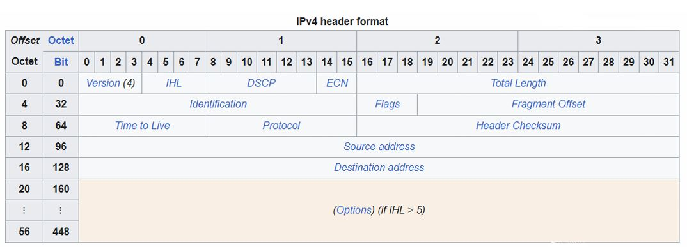

# 📦 IPv4 Header — Complete Study Notes

> **Quick Summary:** The IPv4 header is the metadata attached to every data packet. It tells routers where the packet came from, where it is going, and how to handle it.
> 
- **🎥 Source:** Jeremy's IT Lab CCNA Course — Day 10

---

## 🗺️ How to Read the IPv4 Header (Bit-Map)

The header is structured as a **grid** — think of it as a spreadsheet where data is processed in **32-bit chunks**.

| Axis | Represents | Detail |
| --- | --- | --- |
| **Top Columns** | Individual **Bits** | 0 to 31 |
| **Left Rows** | **Octets (Bytes)** | 1 byte = 8 bits → each 32-bit row = **4 Octets** |

### 💡 The IHL Formula (Critical!)

- **Minimum Header Length:** 20 Bytes (all mandatory fields combined)
- **Minimum IHL Value:** `5` (IHL counts in **4-byte chunks**, not bytes)
    - `5 × 4 = 20 bytes`
- **Maximum IHL Value:** `15`
    - `15 × 4 = 60 bytes` (maximum possible header size with Options)
- **⚠️ The Rule:** **Always multiply the IHL number by 4** to get the actual header length in bytes.

---



## 🏷️ Row-by-Row Field Breakdown

### 🔹 Row 1: Basics & Size (Octet 0 / Bits 0–31)

| Field | Size | Purpose |
| --- | --- | --- |
| **Version** | 4 bits | Specifies IPv4. Fixed binary value: `0100` (decimal 4) |
| **IHL** | 4 bits | Header length. Min: 5 (20 B). Max: 15 (60 B) |
| **DSCP & ECN** | 8 bits | Quality of Service (QoS) and congestion notification |
| **Total Length** | 16 bits | Size of the **entire packet** (Header + Data). Max: 65,535 bytes |

---

### 🔹 Row 2: Packet Fragmentation (Octet 4 / Bits 32–63)

> Used when a packet exceeds the **Maximum Transmission Unit (MTU)** of a link.
> 

| Field | Size | Purpose |
| --- | --- | --- |
| **Identification** | 16 bits | Unique ID to group fragments together |
| **Flags** | 3 bits | Indicates if the packet can be fragmented. ⚠️ *The **More Fragments (MF) bit** is set to 1 on all fragments **except the last one*** |
| **Fragment Offset** | 13 bits | Tells the receiver where this fragment belongs in the original packet |

---

### 🔹 Row 3: Routing & Integrity (Octet 8 / Bits 64–95)

| Field | Size | Purpose |
| --- | --- | --- |
| **TTL** (Time to Live) | 8 bits | Prevents infinite loops. Decrements by 1 at every router hop. If it hits `0`, the packet is **dropped** |
| **Protocol** | 8 bits | Identifies the L4 protocol inside (see cheat sheet below) |
| **Header Checksum** | 16 bits | Error-checks the **header only** (data errors are detected by TCP/UDP) |

---

### 🔹 Row 4 & 5: Addressing (Octet 12 & 16 / Bits 96–159)

| Field | Size | Purpose |
| --- | --- | --- |
| **Source Address** | 32 bits | Sender's IP |
| **Destination Address** | 32 bits | Receiver's IP |

---

### 🔹 Row 6+: Options (Octet 20+ / Bits 160+)

- **Options:** Variable in length. Rarely used.
- If present, it **increases the header size** beyond 20 bytes (up to a max of **60 bytes**).

---

## 🛣️ Protocol Cheat Sheet (L4PDU)

| Decimal Value | Protocol |
| --- | --- |
| **1** | ICMP (Ping) |
| **6** | TCP |
| **17** | UDP |
| **89** | OSPF (Routing) |

---

## 🧠 Knowledge Check (Quiz)

**1. What is the fixed binary value of the first field of an IPv4 header?**

- a) 0010
- b) 0110
- c) 0001
- **d) 0100 ✅** *(The "Version" field, representing decimal 4)*

**2. Which field will cause the packet to be dropped if it has a value of 0?**

- **a) TTL ✅** *(A router discards the packet to prevent loops)*
- b) DSCP
- c) IHL
- d) ECN

**3. How are errors in an IPv4 packet's encapsulated data detected?**

- a) The IPv4 Header Checksum field checks for errors
- **b) The encapsulated protocol (TCP, UDP) checks for errors ✅** *(The IPv4 Header Checksum only checks the header, not the payload)*
- c) Errors in the encapsulated data cannot be detected

**4. Which field of an IPv4 header is variable in length?**

- **a) Options ✅** *(The IHL field is fixed at 4 bits. The Options field itself varies from 0 to 40 bytes)*
- b) Header Checksum
- c) Total Length
- d) IHL

**5. Which bit will be set to 1 on all IPv4 packet fragments except the last fragment?**

- a) Fragment Offset bit
- **b) More Fragments bit ✅** *(It tells the receiver "wait, there's more data coming")*
- c) Don't Fragment bit
- d) Packet Fragment bit

---

## 🛠️ Useful Syntaxes & Commands (Supplemental)

While the lesson focuses on header theory, these practical commands help you **see and verify** IPv4 header fields in real networks.

### 🐧 Linux / Windows — Viewing the Header

| Command | What It Shows |
| --- | --- |
| `ping <destination>` | Generates ICMP (Protocol 1) traffic — watch TTL behavior |
| `traceroute <destination>` (Linux) / `tracert <destination>` (Windows) | Reveals each hop where **TTL decrements** |
| `ping -t <ttl> <destination>` (Windows) / `ping -T <ttl> <destination>` (Linux) | Manually sets the TTL to test hop limits |

### 🖧 Cisco IOS — Verifying Header Behavior

```
! View the routing table (shows MTU per interface — relevant to fragmentation)
show ip route

! Check interface MTU
show interfaces GigabitEthernet0/0

! Debug IP packet (shows header details including TTL, Protocol, etc.)
debug ip packet detail

! Test reachability with a specific TTL (useful for path tracing)
traceroute <destination>
```

### 🦈 Wireshark — Display Filters for Header Fields

```
ip.version == 4                  ! Show only IPv4 packets
ip.ttl < 5                       ! Find packets close to being dropped
ip.flags.mf == 1                 ! Show "More Fragments" packets
ip.frag_offset > 0               ! Show all non-first fragments
ip.proto == 6                    ! Show only TCP (Protocol = 6)
ip.proto == 17                   ! Show only UDP (Protocol = 17)
ip.proto == 1                    ! Show only ICMP (Ping)
ip.len > 1000                    ! Show packets with large Total Length
```

### 📐 Quick Calculation Reference

| Task | Formula | Example |
| --- | --- | --- |
| Actual header size (bytes) | `IHL × 4` | IHL = 5 → 20 bytes |
| Max header size | `15 × 4` | 60 bytes |
| Total packet size | Header + Data | Max 65,535 bytes |
| TTL at hop *N* | `Initial TTL − N` | TTL 64 → 3 hops → 61 |

---

## 🎯 Key Takeaways

- ✅ The IPv4 header is **metadata** — it does not contain the actual payload.
- ✅ **IHL × 4 = actual header length in bytes** (min 20, max 60).
- ✅ **TTL = 0 → packet dropped** (loop prevention).
- ✅ **Header Checksum only checks the header**, not the data.
- ✅ **More Fragments (MF) bit = 1** on every fragment *except the last*.
- ✅ **Protocol field** identifies the L4 protocol: `1 = ICMP`, `6 = TCP`, `17 = UDP`, `89 = OSPF`.
- ✅ **Options field** is the only variable-length field (0–40 bytes).