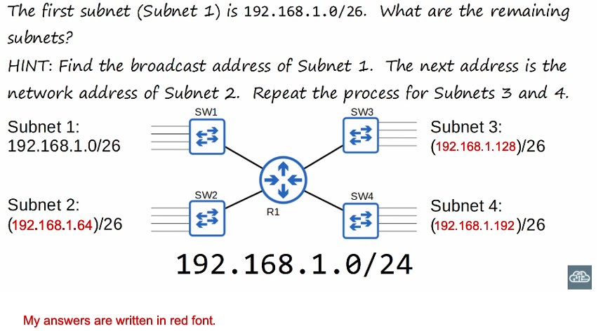

# 🧩 Subnetting Part 1 — Class C Focus

> 📚 **Source:** Jeremy's IT Lab — Day 13 · CCNA 200-301
> 
> 
> 🎯 **Focus:** Intro to IPv4 subnetting, especially **Class C** networks
> 

---

## 🧠 Core Idea

**Subnetting** = dividing one network into smaller, manageable networks using **CIDR / prefix lengths**.

---

## 🗺️ Big Picture

- **IPv4 address classes** define legacy ranges.
- **CIDR** replaced classful addressing → flexible prefix lengths.
- **Subnetting** borrows host bits to create more networks.
- Each subnet has:
    - **Network address**
    - **Usable hosts**
    - **Broadcast address**
- Devices in **different subnets** need a **router / Layer 3 device** to communicate.

---

## 📦 IPv4 Address Classes

| Class | Range | Default Mask | Purpose |
| --- | --- | --- | --- |
| 🅰️ **A** | 1 – 126 | /8 | Large networks |
| 🅱️ **B** | 128 – 191 | /16 | Medium networks |
| 🅲 **C** | 192 – 223 | /24 | Small networks |
| 🅳 **D** | 224 – 239 | — | **Multicast** ✅ |
| 🅴 **E** | 240 – 255 | — | Experimental |
| 🔁 **Loopback** | 127.x.x.x | — | **Loopback** |

> ⚠️ **Remember:** Class D = multicast. 127.x.x.x = loopback.
> 

---

## 🧮 CIDR — Classless Inter-Domain Routing

- **CIDR** = **prefix notation** like `/24`, `/26`, `/30`.
- Replaced old classful rules → allows **any prefix length**.

### ✅ Benefits

- 🎯 Efficient address allocation
- 🧩 **VLSM** — different subnet sizes
- 📦 Route summarization

> 💡 `/26` means: **26 network bits + 6 host bits**.
> 

---

## 🔢 Usable Addresses

For a normal subnet:

```
Usable hosts = 2^(host bits) − 2
```

### Why minus 2?

- ❌ **Network address** (first address)
- ❌ **Broadcast address** (last address)

> **Example:** `/26` → 6 host bits → `2^6 − 2 = 64 − 2 = 62` usable hosts.
> 

---

## 🧪 Special Prefixes

| Prefix | Addresses | Notes |
| --- | --- | --- |
| `/31` | 2 | Point-to-point links; **both usable** (RFC 3021); no broadcast |
| `/32` | 1 | Single host route / loopback-style route |

---

## 🧠 /26 Example — Class C Split

- Class C `/24` = `255.255.255.0`
- Split into `/26` = `255.255.255.192`
- **Block size = 64 addresses** → **4 subnets** per `/24`.

### Example: `192.168.1.0/24` → four `/26` subnets

| Subnet | Network | Usable Range | Broadcast |
| --- | --- | --- | --- |
| 1 | `192.168.1.0/26` | `.1 – .62` | `.63` |
| 2 | `192.168.1.64/26` | `.65 – .126` | `.127` |
| 3 | `192.168.1.128/26` | `.129 – .190` | `.191` |
| 4 | `192.168.1.192/26` | `.193 – .254` | `.255` |

> 🧠 **Memory hook:** `/26 = 64-block, 4 subnets per /24, 62 usable each.`
> 

---

## ❓ If I Use One /26, What Happens to the Other /26 Subnets?

> 💡 **Short answer:** They are **not automatically used**, **not destroyed**, and **not taken by the first subnet**. They remain **available but dormant** until you configure them.
> 

### Example: You assign `192.168.1.0/26` to VLAN 10

- ✅ `.0/26` is **active**.
- 😴 `.64/26`, `.128/26`, `.192/26` are **unused address blocks**.
- 🚫 No devices can use them until an interface/VLAN is configured.
- 🚫 No broadcast domain exists for them yet.
- 🚫 Routers will not forward traffic to them unless routes/interfaces exist.
- 📦 They can be assigned later to other VLANs, router interfaces, or networks.
- 🗑️ If never used, that IP space is simply **wasted** — like empty apartments in a building 🏢.

> 🏢 **Analogy:** The `/24` is a building with 4 apartments (`/26`). Renting one apartment does **not** delete the other three. They stay empty and available.
> 

---

## 🛠️ Subnetting Process — Basics

1. 🔍 **Identify requirements:** number of subnets + hosts per subnet.
2. 📏 **Choose prefix length / subnet mask.**
3. 🧮 **Calculate block size** = `2^(host bits)`.
4. 📋 **List subnet boundaries.**
5. 🏷️ **Assign subnets to VLANs/interfaces.**
6. 🛣️ **Configure routing** so subnets can communicate.
7. ✅ **Verify** with `ping`/`traceroute` and routing table.

---

## 💻 Useful Syntaxes (Bonus — Not in Lesson)

### Configure an IP address on an interface

```
interface GigabitEthernet0/0
 ip address 192.168.1.1 255.255.255.192
 no shutdown
```

### Configure a VLAN interface (SVI)

```
interface Vlan10
 ip address 192.168.1.1 255.255.255.192
 no shutdown
```

### Verify interface IP and status

```
show ip interface brief
show running-config interface GigabitEthernet0/0
```

### Verify routing table

```
show ip route
```

### Test connectivity

```
ping 192.168.1.62
traceroute 192.168.1.62
```

### VLSM example — different subnet sizes

```
! /26 for VLAN 10 (62 hosts)
interface Vlan10
 ip address 192.168.1.1 255.255.255.192

! /27 for VLAN 20 (30 hosts)
interface Vlan20
 ip address 192.168.1.65 255.255.255.224

! /30 for point-to-point link (2 hosts)
interface Serial0/0/0
 ip address 192.168.1.97 255.255.255.252
```

---

## 📌 Extra Info to Remember

- **Network address** = first address in subnet.
- **Broadcast address** = last address in normal subnet.
- **Default gateway** must be in the **same subnet** as the host.
- **Static vs DHCP** = two common address assignment methods.
- Modern networks allow **subnet zero** and **all-ones subnet**; old classful rules sometimes excluded them.
- **VLSM** lets you use different subnet sizes after initial subnetting.
- Subnetting is **administrative** — unused subnets don't "do" anything until configured.

---

## ✅ Quick Recap

- 🅳 **Class D** = multicast.
- 🔁 **127.x.x.x** = loopback.
- 🧮 **/26** = 64 addresses, **62 usable**.
- 🧩 A **/24** becomes **four /26 subnets**.
- 😴 Unused /26 subnets remain **available but inactive**.
- 🛣️ Different subnets need **Layer 3 routing** to communicate.

---

## 🙌 Lesson's Quiz

