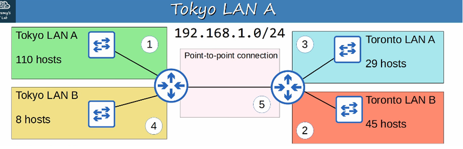

# 🌐 Subnetting Part 2 & VLSM

### *Big networks, same sharp tools.*

> **📌 Context:** This builds on **Subnetting Part 1** and focuses on **Class B subnetting**, **prefix choices**, and **fast subnet/host math** — then extends into **VLSM** for efficient address planning.
> 

---

## 📐 Core Formulas

| Formula | Expression | Notes |
| --- | --- | --- |
| **Subnets** | `2^b` | `b` = borrowed bits |
| **Usable Hosts** | `2^h - 2` | `h` = host bits remaining |
| **Host Bits** | `32 - prefix length` | e.g., `/24` → `32 - 24 = 8` host bits |
| **Block Size** | `256 - mask octet` | Use the octet where the mask is "interesting" (not 255 or 0) |

### 💡 Memory Hook

> **"Borrow for subnets, leave for hosts. Find the block, land the host, write the network."**
> 

---

## 🧠 Quiz Answer Key + Quick Why

### ❓ Q1: Given `172.30.0.0/16`, need **100 subnets** with at least **500 hosts** each. Prefix?

- **✅ Answer:** `/23` or `255.255.254.0`
- **Why:**
    - Need 500 hosts → 9 host bits (`2^9 - 2 = 510`) ✓
    - `32 - 9 = 23` → **`/23`**

---

### ❓ Q2: Host `172.21.111.201/20` belongs to which subnet?

- **✅ Answer:** `172.21.96.0`
- **Why:**
    - `/20` mask = `255.255.240.0` → block size **16** in the 3rd octet
    - `111` falls in the **96–111** block → network = `172.21.96.0`

---

### ❓ Q3: Broadcast address of `192.168.91.78/26`?

- **✅ Answer:** `192.168.91.127`
- **Why:**
    - `/26` mask = `255.255.255.192` → block size **64**
    - `78` falls in the **64–127** block → broadcast = `.127`

---

### ❓ Q4: Divide `172.16.0.0/16` into **4 equal subnets**. Second subnet's network & broadcast?

- **✅ Network:** `172.16.64.0`
- **✅ Broadcast:** `172.16.127.255`
- **Why:**
    - 4 subnets = borrow **2 bits** → `/18`
    - Block size in 3rd octet = **64** → 2nd subnet = **64–127**

---

### ❓ Q5: Divide `172.30.0.0/16` into subnets of **1000 hosts** each. How many subnets?

- **✅ Answer:** **64 subnets**
- **Why:**
    - 1000 hosts → 10 host bits (`2^10 - 2 = 1022`) → new prefix = `/22`
    - Borrowed bits = `22 - 16 = 6`
    - `2^6 = 64` subnets

---

## 🧩 Variable-Length Subnet Masks (VLSM)

### ⚖️ FLSM vs. VLSM

| Feature | **FLSM** (Fixed-Length) | **VLSM** (Variable-Length) |
| --- | --- | --- |
| **Definition** | All subnets use the **same prefix length** | Subnets use **different prefix lengths** |
| **Example** | Dividing a network into four equal `/26`s | Subnets sized to match host requirements |
| **Efficiency** | ❌ Wastes addresses | ✅ Highly efficient |
| **Planning** | Simple | Requires careful planning |

---

### 🪜 The 3-Step VLSM Process

1. **Assign the largest subnet** at the **start** of the address space.
2. **Assign the second-largest subnet** immediately after it.
3. **Repeat** (largest → smallest) until all subnets are assigned.

> **💡 Tip:** Always sort requirements **descending by host count** before assigning.
> 

---

## 🗺️ VLSM Practice Example

**Given:** `192.168.1.0/24`

**Requirements:**

- Tokyo LAN A — **110 hosts**
- Toronto LAN B — **45 hosts**
- Toronto LAN A — **29 hosts**
- Tokyo LAN B — **8 hosts**
- Point-to-Point — **2 hosts**

### 📊 VLSM Allocation Table

| Order / Subnet | Hosts Needed | Prefix | Network Address | Broadcast Address | Usable Range | Total Usable |
| --- | --- | --- | --- | --- | --- | --- |
| 1. Tokyo LAN A | 110 | `/25` | `192.168.1.0` | `192.168.1.127` | `.1 – .126` | **126** |
| 2. Toronto LAN B | 45 | `/26` | `192.168.1.128` | `192.168.1.191` | `.129 – .190` | **62** |
| 3. Toronto LAN A | 29 | `/27` | `192.168.1.192` | `192.168.1.223` | `.193 – .222` | **30** |
| 4. Tokyo LAN B | 8 | `/28` | `192.168.1.224` | `192.168.1.239` | `.225 – .238` | **14** |
| 5. Point-to-Point | 2 | `/30` | `192.168.1.240` | `192.168.1.243` | `.241 – .242` | **2** |

---

### ⚠️ Point-to-Point Note: `/30` vs `/31`

- **`/31`** (RFC 3021):
    - Technically supports **2 hosts**
    - **Saves address space** (no network/broadcast waste)
- **`/30`**:
    - Supports **2 usable hosts** (`2^2 - 2 = 2`)
    - **Recommended** in standard curriculum/testing scenarios

> **📌 Rule of Thumb:** Stick to **`/30`** for point-to-point links in CCNA/standard exam contexts.
> 

---

## 🧮 Quick Reference: Common Prefix Cheat Sheet

| Prefix | Mask | Block Size | Usable Hosts |
| --- | --- | --- | --- |
| `/24` | `255.255.255.0` | 256 | 254 |
| `/25` | `255.255.255.128` | 128 | 126 |
| `/26` | `255.255.255.192` | 64 | 62 |
| `/27` | `255.255.255.224` | 32 | 30 |
| `/28` | `255.255.255.240` | 16 | 14 |
| `/29` | `255.255.255.248` | 8 | 6 |
| `/30` | `255.255.255.252` | 4 | 2 |
| `/31` | `255.255.255.254` | 2 | 2 (RFC 3021) |

---

## 🔑 Key Takeaways

- 🧠 **Borrow bits for subnets, leave bits for hosts** — this is the golden rule.
- 📏 **Block size = 256 − mask octet** — use it to find network boundaries fast.
- 🎯 **Prefix choice** is driven by **host requirements first**, then subnet count.
- 🧩 **VLSM** = sort largest → smallest, allocate sequentially.
- ⚠️ Use **`/30`** for point-to-point; avoid `/31` in standard exam scenarios.
- 💡 Always verify: **network address** (even), **broadcast** (odd boundary − 1), **usable range** in between.