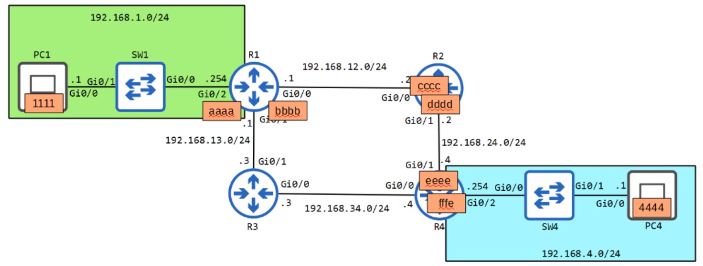

# 📦 The Life of a Packet: A Journey Across Networks 🌐

This lesson provides a step-by-step walkthrough of how a packet travels from a source computer to a remote destination, focusing on the roles of ARP, encapsulation, and routing.

#### 🎯 The Main Goal

To understand the complete process of sending a packet from **PC1 (192.168.1.1)** to **PC4 (192.168.4.1)**.

#### 🗺️ The Network Path

The packet will follow this pre-configured path:
**PC1 → R1 → R2 → R4 → PC4**

**Important Note:** Each router interface has a unique MAC address. Switches are not shown with MAC addresses to keep the diagram simple, as they don't modify the packet's IP or MAC addresses.

---

### 🚶‍♂️ The Step-by-Step Journey

#### Step 1: PC1 Wants to Send Data to PC4

- **Action:** PC1 prepares an IP packet with **Source IP: 192.168.1.1** and **Destination IP: 192.168.4.1**.
- **Problem:** PC1 recognizes that PC4 is on a different network. It must send the packet to its default gateway (**R1**), but it doesn't know R1's MAC address.
- **Solution:** PC1 uses **ARP (Address Resolution Protocol)** .

#### Step 2: The First ARP (PC1 → R1)

- **ARP Request:** PC1 broadcasts a frame to all devices on its local network.
    - **Source IP:** 192.168.1.1 (PC1)
    - **Destination IP:** 192.168.1.254 (R1's G0/2 interface)
    - **Source MAC:** 1111 (PC1)
    - **Destination MAC:** FFFF.FFFF.FFFF (Broadcast)
- **ARP Reply:** R1 receives the broadcast, sees its IP is the target, and sends a **unicast** reply back to PC1.
    - **Message:** "Hi PC1, my MAC address is AAAA."
- **Result:** PC1 now knows R1's MAC address.

#### Step 3: PC1 Sends the Packet to R1

- **Action:** PC1 encapsulates the original IP packet in a new Ethernet frame and sends it to R1.
- **Key Point:** The **IP addresses remain unchanged** (Source: PC1, Destination: PC4). Only the MAC addresses are for the local link.
    - **Source MAC:** 1111 (PC1)
    - **Destination MAC:** AAAA (R1)

#### Step 4: R1 Forwards the Packet to R2

- **Action:** R1 receives the frame, removes the Ethernet header, and looks up the destination IP (192.168.4.1) in its routing table. The next hop is **R2 (192.168.12.2)** .
- **Problem:** R1 doesn't know R2's MAC address.
- **Solution:** R1 performs ARP for R2's IP.
- **ARP Process:** Same as before. R1 broadcasts an ARP request, and R2 replies with its MAC address (**CCCC**).
- **Forwarding:** R1 encapsulates the packet in a new frame and sends it to R2.
    - **Source MAC:** BBBB (R1)
    - **Destination MAC:** CCCC (R2)

#### Step 5: R2 Forwards the Packet to R4

- **Action:** R2 receives the frame, de-encapsulates it, and looks up the destination IP. The next hop is **R4 (192.168.24.4)** .
- **ARP Process:** R2 performs ARP to learn R4's MAC address (**EEEE**).
- **Forwarding:** R2 encapsulates the packet in a new frame and sends it to R4.
    - **Source MAC:** DDDD (R2)
    - **Destination MAC:** EEEE (R4)

#### Step 6: R4 Delivers the Packet to PC4

- **Action:** R4 receives the frame, de-encapsulates it, and sees that PC4's network (192.168.4.0/24) is directly connected.
- **ARP Process:** R4 performs ARP to learn PC4's MAC address (**4444**).
- **Final Delivery:** R4 encapsulates the packet in a final frame and sends it to PC4.
    - **Source MAC:** FFFE (R4)
    - **Destination MAC:** 4444 (PC4)

---

### 🔑 Key Takeaways

- **The IP Packet is Constant:** The original IP packet (Source: 192.168.1.1, Destination: 192.168.4.1) is **never modified** by the routers. It is only de-encapsulated and re-encapsulated with new Ethernet headers.
- **MAC Addresses are Local:** MAC addresses are only used for communication on the local network segment. They change at every router hop.
- **Switches Don't Change Frames:** Switches operate at Layer 2. They forward frames based on MAC addresses but do not modify the IP packet or the Ethernet frame's source/destination MAC addresses.
- **ARP is Essential:** ARP is the bridge between Layer 3 (IP addresses) and Layer 2 (MAC addresses). It's used to discover the MAC address associated with a known IP address on the local network.

---

### 🧠 Quiz Time!

**Question 1:** PC4 sends a packet to PC1. What is the **destination MAC address** when it is sent from PC4’s network interface?

**Question 2:** PC4 sends a packet to PC1. What is the **source MAC address** when it is received on R1’s Gi0/0 interface?

**Question 3:** PC4 sends a packet to PC1. What is the **source MAC address** when it is sent from SW1’s Gi0/1 interface?

**Question 4:** PC4 sends a packet to PC1. What is the **destination IP address** when it is sent from R4’s Gi0/1 interface?

**Question 5:** PC4 sends a packet to PC1. What is the **source IP address** when it is received on R1’s Gi0/0 interface?

---

### ✅ Answer Key

1. **FFFE** (The MAC address of R4's G0/2 interface, PC4's default gateway).
2. **CCCC** (The MAC address of R2's G0/0 interface, the device sending the frame to R1).
3. **AAAA** (The MAC address of R1's G0/2 interface. Switches do not change the source MAC address).
4. **192.168.1.1** (The IP address of PC1. Routers do not change the destination IP of the original packet).
5. **192.168.4.1** (The IP address of PC4. Routers do not change the source IP of the original packet).

---

### 📚 Syntax & Reference

- **ARP (Address Resolution Protocol):** Used to discover a MAC address when the IP address is known.
- **Default Gateway:** The router that a device sends traffic to when the destination is on a different network.
- **Encapsulation/De-encapsulation:** The process of adding or removing protocol headers (like an Ethernet header) as data moves through the network layers.
- **Unicast:** A frame sent to a single, specific destination MAC address.
- **Broadcast:** A frame sent to all devices on a local network, using the MAC address `FFFF.FFFF.FFFF`.