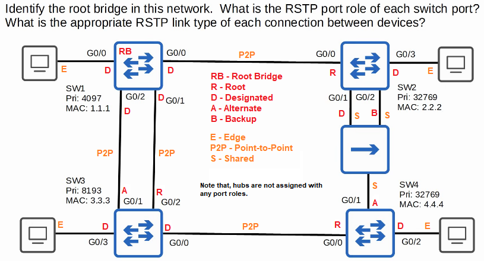

# 📚 Jeremy's IT Lab: Rapid Spanning Tree (RSTP & Rapid PVST+)

> **📝 Note on Verification:** The information below has been fact-checked against Cisco documentation and other reliable sources. Key points regarding port states, roles, link types, BPDU details, and command syntax are confirmed to be correct.
> 

---

### 🎯 Video Overview

- **Topic:** Rapid Spanning Tree Protocol (RSTP), focusing on Cisco's **Rapid PVST+**.
- **Goal:** To understand how RSTP improves upon classic STP (802.1D) for faster network convergence and to learn its key concepts, port roles, and configuration.
- **Prerequisite:** Familiarity with classic STP/PVST+ is assumed.

---

### 📊 Comparison of Spanning Tree Versions

This table summarizes the different versions of STP discussed in the video.

| Feature | **IEEE 802.1D (STP)** | **PVST+ (Cisco)** | **IEEE 802.1w (RSTP)** | **Rapid PVST+ (Cisco)** | **IEEE 802.1s (MSTP)** |
| --- | --- | --- | --- | --- | --- |
| **Standard** | IEEE Standard | Cisco Proprietary | IEEE Standard | Cisco Proprietary | IEEE Standard |
| **Key Feature** | Original STP, slow convergence | Per-VLAN instance | Fast convergence, single instance | Per-VLAN instance & fast convergence | Groups multiple VLANs into instances |
| **Load Balancing** | ❌ No | ✅ Yes | ❌ No | ✅ Yes | ✅ Yes |
| **Default on Modern Cisco Switches** | ❌ No | ❌ No | ❌ No | ✅ **Yes** (Rapid PVST+ is default) | ❌ No |
| **Use Case** | Legacy | Legacy | Legacy | **Small to Medium Networks** | **Large Networks** |

> **💡 Key Takeaway:** For most modern CCNA-level networks, **Rapid PVST+** is the protocol you will use. It offers the speed of RSTP and the flexibility of per-VLAN load balancing.
> 

---

### ⚡ Rapid Spanning Tree (RSTP) Core Concepts

RSTP is an **evolution**, not a revolution, of STP. It speeds up convergence by using a **negotiation process** (a "handshake" between switches) instead of relying on long, fixed timers.

#### ✅ Similarities with Classic STP

- **Purpose:** Both prevent Layer 2 loops.
- **Root Bridge Election:** Lowest Bridge ID wins.
- **Root Port Election:** Lowest root cost to the root bridge wins.
- **Designated Port Election:** Port on the segment with the lowest root cost becomes designated.

#### 🔄 Key Differences: Faster Convergence

- **Mechanism:** RSTP uses a **proposal-agreement handshake** to rapidly move ports to a forwarding state without waiting for timers.
- **Convergence Time:** Classic STP can take **30-50 seconds**. RSTP can converge in **under a few seconds** (often within 3 hello times, which is 6 seconds).

#### 🔢 Updated Port Costs

RSTP uses a wider range of values to accommodate higher-speed links.

| Link Speed | **RSTP Cost (Long Mode)** |
| --- | --- |
| 10 Mbps | 2,000,000 |
| 100 Mbps | 200,000 |
| 1 Gbps | 20,000 |
| 10 Gbps | 2,000 |
| 100 Gbps | 200 |
| 1 Tbps | 20 |

---

### 🚦 RSTP Port States (3 States)

RSTP simplifies the port states by combining the functions of classic STP states.

| Operational Status | **Classic STP (802.1D) State** | **RSTP (802.1w) State** |
| --- | --- | --- |
| Enabled (Blocking) | Blocking | **Discarding** |
| Enabled (Listening) | Listening | **Discarding** |
| Disabled | Disabled | **Discarding** |
| Enabled (Learning) | Learning | **Learning** |
| Enabled (Forwarding) | Forwarding | **Forwarding** |

> **🔑 Important:** The **Listening** state is eliminated in RSTP. The **Blocking** and **Disabled** states are merged into the **Discarding** state.
> 

---

### 👑 RSTP Port Roles (4 Roles)

RSTP expands on the classic port roles by splitting the "non-designated" role into two distinct types.

1. **Root Port:** Unchanged. The port with the lowest cost path to the root bridge.
2. **Designated Port:** Unchanged. The port on a network segment that sends the best BPDU.
3. **Alternate Port:**
    - **Role:** A **discarding** port that receives a **superior BPDU from another switch**.
    - **Function:** Acts as a **backup to the root port**. If the root port fails, the switch can immediately move the alternate port to forwarding. This built-in feature is similar to the classic **UplinkFast** feature.
4. **Backup Port:**
    - **Role:** A **discarding** port that receives a **superior BPDU from another interface on the *same* switch** (e.g., when connected to a hub).
    - **Function:** Acts as a **backup to a designated port**.
    - **Note:** This is rare in modern networks because hubs are obsolete.

---

### 🔗 RSTP Link Types

RSTP distinguishes between three link types to determine how quickly a port can transition.

| Link Type | Connected To | Behavior | Configuration |
| --- | --- | --- | --- |
| **Edge** | End hosts (PCs, servers) | Immediately moves to forwarding, skipping negotiation. | `spanning-tree portfast` |
| **Point-to-Point** | Another switch (full-duplex) | Uses a **negotiation process** for rapid transition. | Auto-detected (full-duplex) |
| **Shared** | A hub (half-duplex) | Operates in half-duplex; slow convergence, similar to classic STP. | Auto-detected (half-duplex) |

> **📌 Syntax Note:** To configure an edge port, you use the `spanning-tree portfast` command, not a `link-type edge` command. This is a common exam trick.
> 

---

### 📨 RSTP BPDU (Bridge Protocol Data Unit)

- **Protocol Version:** **2** (Classic STP uses version 0).
- **BPDU Type:** **2** (Classic STP uses type 0).
- **BPDU Flags:** Uses **all 8 bits** of the flag byte for the negotiation process (Classic STP uses only 2).
- **BPDU Origination:** **All switches** running RSTP originate and send their own BPDUs from their designated ports. In classic STP, only the root bridge originates BPDUs.

---

### ⚙️ Built-in Optional Features

Several classic STP optional features are built into RSTP by default and do not require manual configuration.

- **PortFast:** Built-in as the **Edge Port** functionality.
- **UplinkFast:** Built-in as the rapid transition of the **Alternate Port** to a Root Port.
- **BackboneFast:** Built-in as the process for rapidly expiring the Max Age timer on an interface when a superior BPDU is received.

---

### ⚠️ Interoperability with Classic STP

RSTP is compatible with classic STP. If an RSTP switch is connected to a classic STP switch, the interface on the RSTP switch will **automatically revert to classic STP mode** (using classic timers and state transitions) to ensure compatibility.

---

### 📝 Configuration & Verification Commands

Here is a summary of the key command-line interface (CLI) commands discussed.

| Command | Mode | Purpose |
| --- | --- | --- |
| `spanning-tree mode rapid-pvst` | Global Config | Changes the STP mode to Rapid PVST+. **This is often the default**. |
| `spanning-tree portfast` | Interface Config | Configures a port as an RSTP **Edge Port**. |
| `spanning-tree link-type point-to-point` | Interface Config | Manually configures the link type. |
| `spanning-tree link-type shared` | Interface Config | Manually configures the link type. |
| `show spanning-tree` | Privileged EXEC | Verifies the STP mode and port roles/states. |

> **💡 Verification Tip:** In the `show spanning-tree` output, Rapid PVST+ will display the protocol as **"rstp"**. The port status may still be listed as **"BLK"** (blocking) for discarding ports for consistency with classic STP, but the state is functionally **discarding**.
> 

---

### ❓ Quiz Questions

**Q1. Identify the root bridge and the RSTP port role of each switch interface in the provided network diagram (with a hub).**



**Q2. Which IEEE 802.1D optional features were built into the IEEE 802.1w standard, and allow ports to move rapidly to the forwarding state? (Select three)**

- **A)** Root Guard
- **B)** PortFast
- **C)** BPDU Guard
- **D)** UplinkFast
- **E)** BackboneFast
- **F)** Loop Guard
- **G)** RootFast

> **Answer:** **B, D, E**
> 
> - **PortFast** is built-in as **Edge Port** functionality.
> - **UplinkFast** is built-in for rapid failover to an **Alternate Port**.
> - **BackboneFast** is built-in for rapid expiration of the Max Age timer.

**Q3. You want to configure an 802.1w edge port so that hosts can begin sending traffic immediately. Which command should you use?**

- **A)** `spanning-tree link-type edge`
- **B)** `spanning-tree mode edge`
- **C)** `spanning-tree link-type portfast`
- **D)** `spanning-tree portfast`

> **Answer:** **D) `spanning-tree portfast`**
> 
> - This command configures the port as an RSTP edge port, enabling it to transition immediately to the forwarding state.

**Q4. (Boson ExSim) Which of the following optional STP features reduces convergence time by immediately placing edge ports into a forwarding state?**

- **A)** Root Guard
- **B)** BPDU Guard
- **C)** PortFast
- **D)** BPDU Filter
- **E)** Loop Guard

> **Answer:** **C) PortFast**
> 
> - PortFast (and the RSTP Edge Port feature) is designed specifically to bypass the listening and learning states for ports connected to end devices.

---

### 📋 Master Command Syntax List

```bash
! Global Configuration
spanning-tree mode rapid-pvst

! Interface Configuration
spanning-tree portfast
spanning-tree link-type point-to-point
spanning-tree link-type shared

! Verification
show spanning-tree
```