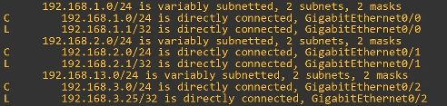
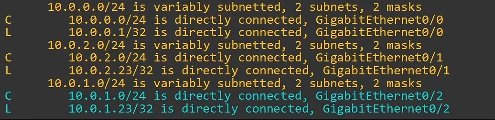

# 🎯 Routing Fundamentals - CCNA Study Notes

## 📚 Overview

This lesson covers **routing fundamentals** - a critical topic for the CCNA exam and networking in general. Routers use routing tables (similar to how switches use MAC address tables) to forward packets to their correct destinations.

---

## 🔍 What is Routing?

**Routing** is the process routers use to determine the path that IP packets should take over a network to reach their destination.

| Device | Table Used | Purpose |
| --- | --- | --- |
| Switch | MAC Address Table | Forward frames to correct destination |
| Router | Routing Table | Forward packets to correct destination |

### 📌 Two Main Routing Methods

1. **Dynamic Routing** - Routers use protocols (like OSPF) to automatically share routing information
2. **Static Routing** - Network admin manually configures routes

> ⚠️ This lesson focuses on **Connected** and **Local** routes - automatically added routes that fit neither category above.
> 

---

## 📋 What is a Route?

A route is an **instruction** to the router:

- "To reach destination X, send the packet to next-hop Y"
- **Next-hop** = the next router in the path to the destination
- If destination is directly connected → send directly
- If destination is the router's own IP → receive for yourself, don't forward

---

## 🖥️ The Routing Table

### Command: `SHOW IP ROUTE`

Displays the router's routing table with two main sections:

1. **Codes legend** (top) - Lists protocols and their codes
2. **Routes** (bottom) - The actual routing entries

### 📖 Key Route Codes

| Code | Meaning | Description |
| --- | --- | --- |
| **C** | Connected | Route to the network the interface is connected to |
| **L** | Local | Route to the exact IP address on the interface (/32) |

### 🔄 Automatic Route Addition

When you configure an IP address on an interface and enable it (`NO SHUTDOWN`):

- **2 routes per interface** are automatically added:
    - 1 Connected route (C)
    - 1 Local route (L)

---

## 🔗 Connected Routes (Code: C)

### Definition

A route to the **network** the interface is connected to.

### Example

- Interface IP: `192.168.1.1/24`
- Connected route: `192.168.1.0/24`
- **/24** = First 24 bits (3 octets) are network portion, last 8 bits are host portion

### Behavior

> "To send a packet to any host in this network (192.168.1.0 - 192.168.1.255), send it out of the specified interface."
> 

### Matching Examples

| Destination IP | Matches 192.168.1.0/24? |
| --- | --- |
| 192.168.1.2 | ✅ Yes |
| 192.168.1.7 | ✅ Yes |
| 192.168.1.89 | ✅ Yes |
| 192.168.2.1 | ❌ No |

---

## 📍 Local Routes (Code: L)

### Definition

A route to the **exact IP address** configured on the interface (uses /32 netmask).

### Example

- Interface IP: `192.168.1.1/24`
- Local route: `192.168.1.1/32`
- **/32** = All 32 bits are fixed (255.255.255.255)

### Behavior

> "If I receive a packet for this exact IP address, the message is for me. Receive it, don't forward it."
> 

### Matching

- `192.168.1.1/32` matches **ONLY** destination `192.168.1.1`
- Does NOT match `192.168.1.2`, `.3`, etc.

---

## 🎯 Route Selection: Most Specific Match

### The Problem

A packet destined for `192.168.1.1` matches BOTH:

- `192.168.1.0/24` (Connected route)
- `192.168.1.1/32` (Local route)

**Which route wins?**

### The Rule

> **The router selects the most specific matching route.**
> 

**Most specific** = the matching route with the **longest prefix length**

### Comparison

| Route | IP Addresses Included | Prefix Length |
| --- | --- | --- |
| 192.168.1.0/24 | 256 addresses (.0 - .255) | /24 |
| 192.168.1.1/32 | 1 address (.1 only) | /32 |

→ **/32 is more specific** → Local route is selected

### Key Points

1. Route must **match** the packet's destination
2. Among matching routes, choose the one with the **longest prefix length**

---

## 📊 Practice Examples

| Packet Destination | Matching Routes | Selected Route | Action |
| --- | --- | --- | --- |
| 192.168.1.1 | 1.0/24, 1.1/32 | 1.1/32 (Local) | Receive for itself |
| 192.168.13.3 | 13.0/24 | 13.0/24 (Connected) | Forward out G0/0 |
| 192.168.1.244 | 1.0/24 | 1.0/24 (Connected) | Forward out G0/2 |
| 192.168.12.1 | 12.0/24, 12.1/32 | 12.1/32 (Local) | Receive for itself |
| 192.168.4.10 | No match | None | **Drop packet** |

---

## ⚠️ Router vs Switch Behavior

| Behavior | Switch | Router |
| --- | --- | --- |
| Unknown destination | **Floods** frame | **Drops** packet |
| Match type | **Exact** match in MAC table | **Most specific** match |
| Broadcast handling | Floods | Does not flood |

> 🔑 **Routers NEVER flood packets.** If no route matches, the packet is dropped.
> 

---

## 📝 About the "Variably Subnetted" Lines

Lines like this in `SHOW IP ROUTE` output:

```
192.168.1.0/24 is variably subnetted, 2 subnets, 2 masks
```

**These are NOT routes!** They indicate:

- 2 routes exist within the 1.0/24 network
- With 2 different masks (/24 and /32)

> 💡 Generally, you can ignore these lines and focus on the actual routes.
> 

---

## 💻 Command Syntax Reference

| Command | Purpose |
| --- | --- |
| `SHOW IP ROUTE` | Display the routing table |
| `SHOW IP INTERFACE BRIEF` | Verify interface IP addresses |
| `INTERFACE G0/0` | Enter interface configuration mode |
| `IP ADDRESS [ip] [mask]` | Configure IP address on interface |
| `NO SHUTDOWN` | Enable the interface |

### Configuration Example

```
R1(config)# interface G0/0
R1(config-if)# ip address 192.168.13.1 255.255.255.0
R1(config-if)# no shutdown
R1(config-if)# interface G0/1    ← Can go directly to next interface
R1(config-if)# ip address 192.168.12.1 255.255.255.0
R1(config-if)# no shutdown
```

> 💡 **Tip:** You can use `INTERFACE G0/1` directly from interface config mode - no need to return to global config first.
> 

---

## 📝 Quiz Questions & Answers

### Question 1

**The IP address configured on a router interface will appear in the routing table as what kind of route?**

- A) Static
- B) Connected
- C) Local
- D) Dynamic

**Answer: C) Local**

> The IP address appears as a Local route (/32). A Connected route is also added for the network.
> 

---

### Question 2

**Examine R1's routing table. What will it do when it receives a packet destined for 192.168.3.25?**



- A) Forward it out G0/1
- B) Receive the packet for itself
- C) Drop the packet
- D) Flood the packet

**Answer: B) Receive the packet for itself**

> R1 has a local route to 192.168.3.25/32, meaning this IP is configured on its interface.
> 

---

### Question 3

**Which of the following statements about the behavior of routers and switches are true? (Select two)**

- A) Routers flood packets with unknown destinations
- B) Switches flood frames with unknown destinations
- C) Routers drop packets with unknown destinations
- D) Switches drop frames with unknown destinations

**Answer: B and C**

> • Switches **flood** unknown unicast frames
• Routers **drop** packets with no matching route
> 

---

### Question 4

**Which two types of routes are automatically added to the routing table when you configure an IP address on an interface and enable it?**

- A) C and L
- B) S and D
- C) O and R
- D) C and S

**Answer: A) C and L**

> • **C** = Connected (route to the network)
• **L** = Local (route to exact IP address)
> 

---

### Question 5

**Examine R1's routing table. If R1 receives a packet destined for 10.0.1.23, how many routes match that destination? And which is the most specific matching route?**



- A) 1 route; 10.0.1.0/24
- B) 1 route; 10.0.1.23/32
- C) 2 routes; most specific is 10.0.1.23/32
- D) 2 routes; most specific is 10.0.1.0/24

**Answer: C) 2 routes; most specific is 10.0.1.23/32**

> Both routes match, but /32 has a longer prefix length, so it's more specific. Since it's a Local route, R1 receives the packet for itself.
> 

---

## 🧠 Key Takeaways

1. 📖 **Routing** = process of determining packet path through network
2. 📋 **Routing table** = set of instructions for forwarding packets
3. 🔗 **Connected routes (C)** = routes to directly connected networks
4. 📍 **Local routes (L)** = routes to the router's own IP addresses (/32)
5. 🎯 **Route selection** = most specific match (longest prefix length)
6. 🚫 **Routers never flood** - they drop packets with no matching route
7. ✅ Two routes auto-added per configured interface: Connected + Local

---

## 📌 Quick Comparison: Router vs Switch

| Feature | Switch | Router |
| --- | --- | --- |
| Table | MAC Address Table | Routing Table |
| Matching | Exact match | Most specific match |
| Unknown destination | Flood | Drop |
| Works with | Frames (Layer 2) | Packets (Layer 3) |