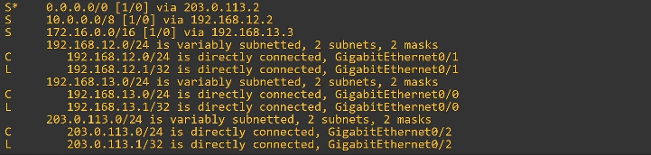
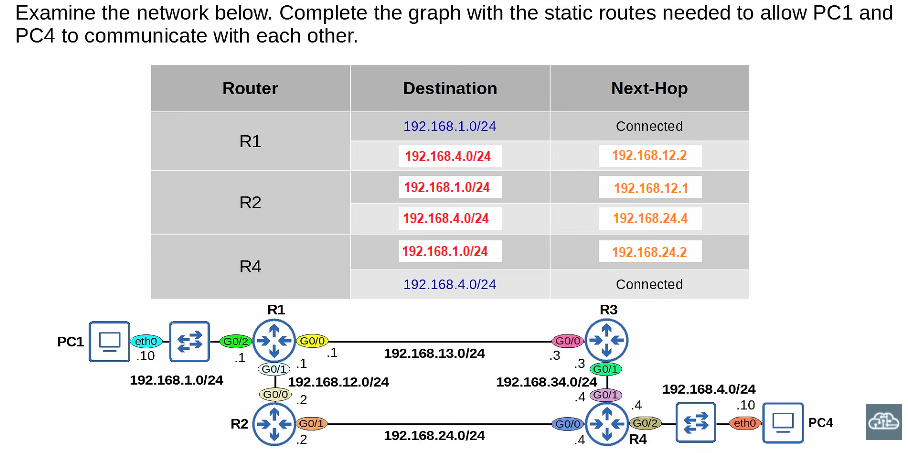
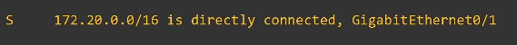
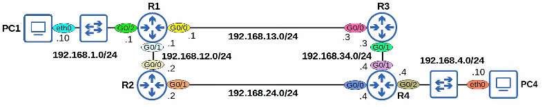

# 📘 Static Routing — CCNA

> ✅ **Accuracy check:** The transcript matches CCNA-level static routing behavior. No major technical errors found.
> 
> 
> 📝 Transcription quirks: short forms like **1.0/24**, **4.0/24**, **12.0/24**, **24.0/24** mean **192.168.1.0/24**, **192.168.4.0/24**, **192.168.12.0/24**, **192.168.24.0/24** in context. The transcript’s “one slash zero” means static route output like **[1/0]** = administrative distance / metric.
> 

---

## 🎯 Lesson Goals

- Review **Connected** and **Local** routes
- Understand **Static Routes**
- Configure static routes on Cisco routers
- Understand **Default Routes**
- Verify two-way reachability between PC1 and PC4

---

## 🔁 Connected and Local Routes Review

- Added automatically when you configure an IP address on an interface.
- Interface must be **enabled**; otherwise routes do not appear.
- **C = Connected** → route to the network the interface is connected to.
- **L = Local** → route to the router’s own exact IP address, usually /32.

### 🧮 Examples

- **R2** with 2 interfaces → 4 routes:
    - Connected: 192.168.12.0/24 and 192.168.24.0/24
    - Local: 192.168.12.2/32 and 192.168.24.2/32
- **R3** with 2 interfaces → 4 routes:
    - Connected: 192.168.13.0/24 and 192.168.34.0/24
    - Local: 192.168.13.3/32 and 192.168.34.3/32
- **R4** with 3 interfaces → 6 routes:
    - 3 Connected and 3 Local

> 🚫 Routers know their own IPs and directly connected networks, but not remote networks unless routes are added.
> 

---

## 🚪 Default Gateway for End Hosts

- End hosts can send directly to hosts in their own connected network.
- For outside destinations, they send traffic to their **default gateway**.
- “Gateway” is an old term for **router**.
- Default gateway = default route = route to **0.0.0.0/0**.
- **0.0.0.0/0** includes every IPv4 address; it is the **least specific** route.
- A **/32** route is the **most specific** route.
- Default route rule: if no more specific route matches, use the default route instead of dropping the packet.

### 💻 PC1 Example

- IP: 192.168.1.10/24
- Default gateway: 192.168.1.1
- To reach PC4 at 192.168.4.10:
    - Layer 3 destination IP = 192.168.4.10
    - Layer 2 destination MAC = R1 G0/2 MAC address
    - PC1 uses ARP to learn the gateway MAC; ARP details are covered later in “Life of a Packet.”

---

## 🛣️ Static Routes

- Static routes are **manually configured**.
- They tell the router how to reach **remote destinations**.
- Routers need routes for **two-way reachability**.
- Routers do **not** need routes to every network in the path, only the next hop for each destination.

### 🧭 Route Planning for PC1 to PC4 via R3

Path used in this lesson: **PC1 → R1 → R3 → R4 → PC4**

| Router | Destination | Next Hop |
| --- | --- | --- |
| R1 | 192.168.4.0/24 | 192.168.13.3 — R3 G0/0 |
| R3 | 192.168.1.0/24 | 192.168.13.1 — R1 G0/0 |
| R3 | 192.168.4.0/24 | 192.168.34.4 — R4 G0/1 |
| R4 | 192.168.1.0/24 | 192.168.34.3 — R3 G0/1 |
- R1 already has a connected route to 192.168.1.0/24.
- R4 already has a connected route to 192.168.4.0/24.
- R2 path exists as an alternative, but this lesson uses the R3 path.
- Later topics: load balancing and backup paths.

---

## ⚙️ Static Route Configuration Examples

### R1

```
ip route 192.168.4.0 255.255.255.0 192.168.13.3
```

### R3

```
ip route 192.168.1.0 255.255.255.0 192.168.13.1
ip route 192.168.4.0 255.255.255.0 192.168.34.4
```

### R4

```
ip route 192.168.1.0 255.255.255.0 192.168.34.3
```

### Verify

```
show ip route
```

- Static route code: **S**
- Example output may show **[1/0]** = administrative distance / metric.
- AD and metric are covered later; no need to master them now.

### ✅ Ping Test

- Ping from PC1 to PC4 succeeded: 5 transmitted, 5 received, 0% loss.
- Successful ping proves **two-way reachability**.

---

## 📦 Packet Encapsulation Preview

- Source and destination **IP addresses do not change** through the path.
- Source and destination **MAC addresses change** at every hop.
- Each router de-encapsulates the frame, checks the routing table, then re-encapsulates in a new frame.
- Final hop: R4 sends to PC4 with PC4’s MAC as destination.
- Only at the final delivery are destination IP and destination MAC for the same device.
- Full step-by-step details come in the “Life of a Packet” video.

---

## 🔀 Static Route Options

You can configure a static route using:

1. **Next-hop IP only**

```
ip route DEST_NETWORK NETMASK NEXT_HOP_IP
```

1. **Exit-interface only**

```
ip route DEST_NETWORK NETMASK EXIT_INTERFACE
```

1. **Both exit-interface and next-hop**

```
ip route DEST_NETWORK NETMASK EXIT_INTERFACE NEXT_HOP_IP
```

### R2 Examples

```
ip route 192.168.1.0 255.255.255.0 g0/0
ip route 192.168.4.0 255.255.255.0 g0/1 192.168.24.4
```

- Exit-interface-only static routes display as **directly connected** in the routing table.
- They rely on **Proxy ARP**.
- Proxy ARP is beyond CCNA scope.
- Usually use next-hop only, or both exit-interface and next-hop.

---

## 🌟 Default Routes on Cisco Routers

- Default route = route to **0.0.0.0/0**
- Netmask bits are all 0.
- It is the least specific route and matches every destination.
- Used when no more specific route matches.
- Common use: send Internet-bound traffic to an ISP or upstream router.

### Configuration

```
ip route 0.0.0.0 0.0.0.0 203.0.113.2
```

### Routing Table Notes

- **S** means **candidate default**.
- Multiple candidates are possible.
- If selected, output shows:
    - **Gateway of last resort is 203.0.113.2 to network 0.0.0.0**
- “Gateway of last resort” = default gateway.

---

## 🧪 Quiz

### Q1. Which command configures a default route on a Cisco router?

A. `ip route 0.0.0.0 0.0.0.0 10.1.1.255`

B. `ip route 0.0.0.0/0 10.1.1.255`

C. `ip route 0.0.0.0 255.255.255.255 10.1.1.255`

D. `ip route 0.0.0.0/0 255.255.255.255 10.1.1.255`

✅ **Answer: A**

- Cisco static route commands require a written netmask, not slash prefix length.
- Default route netmask must be 0.0.0.0.
- C uses 255.255.255.255, which is wrong.

---

### Q2. Examine R1’s routing table. Which interface forwards packets to 8.8.8.8?



✅ **Answer: C — GigabitEthernet0/2**

- Only the default route matches 8.8.8.8.
- Default route next hop is 203.0.113.2.
- 203.0.113.0/24 is directly connected to G0/2, so R1 uses G0/2.

---

### Q3. Complete static routes for PC1 and PC4 using the path via R2.



✅ **Answers:**

```
! R1
ip route 192.168.4.0 255.255.255.0 192.168.12.2

! R2
ip route 192.168.1.0 255.255.255.0 192.168.12.1
ip route 192.168.4.0 255.255.255.0 192.168.24.4

! R4
ip route 192.168.1.0 255.255.255.0 192.168.24.2
```

---

### Q4. A static route shows the network as directly connected. What command configured it?



✅ **Answer: D**

```
ip route 172.20.0.0 255.255.0.0 g0/1
```

- Route code is **S**, so it is static, not connected.
- 172.20.0.0/16 is a network address; it cannot be configured as an interface IP.
- Exit-interface-only static routes display as directly connected and use Proxy ARP.

---

### Q5. How many static routes must R3 configure to know all destination networks?



✅ **Answer: D — 4 routes**

- R3 already knows connected networks 192.168.13.0/24 and 192.168.34.0/24.
- Additional routes needed:
    - 192.168.1.0/24
    - 192.168.4.0/24
    - 192.168.12.0/24
    - 192.168.24.0/24

---

## 🧾 Command Syntax Cheat Sheet

```
! Static route with next-hop
ip route DEST_NETWORK NETMASK NEXT_HOP_IP

! Static route with exit-interface only
ip route DEST_NETWORK NETMASK EXIT_INTERFACE

! Static route with both exit-interface and next-hop
ip route DEST_NETWORK NETMASK EXIT_INTERFACE NEXT_HOP_IP

! Default route
ip route 0.0.0.0 0.0.0.0 NEXT_HOP_IP

! Verify routing table
show ip route

! Lesson examples
ip route 192.168.4.0 255.255.255.0 192.168.13.3
ip route 192.168.1.0 255.255.255.0 192.168.13.1
ip route 192.168.4.0 255.255.255.0 192.168.34.4
ip route 192.168.1.0 255.255.255.0 192.168.34.3
ip route 192.168.1.0 255.255.255.0 g0/0
ip route 192.168.4.0 255.255.255.0 g0/1 192.168.24.4
ip route 0.0.0.0 0.0.0.0 203.0.113.2
```

> ⚠️ Cisco static route syntax does **not** accept `/prefix` in the command. Write the netmask.
>