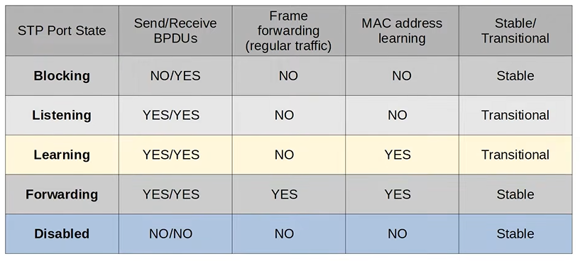
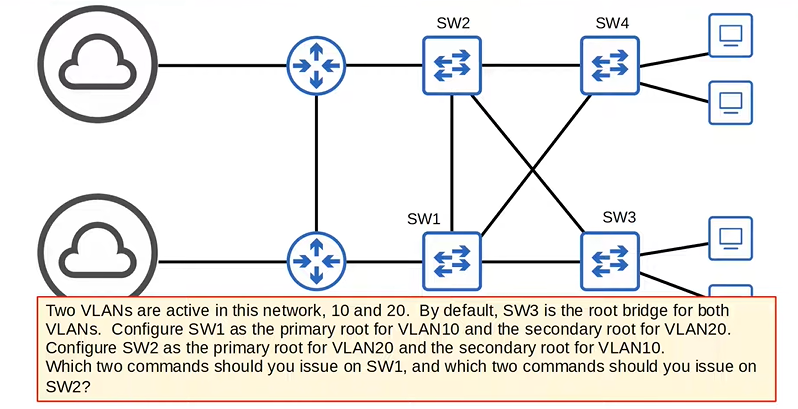
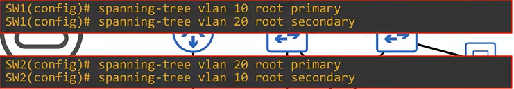

# 🌳 Spanning Tree Protocol (STP) - Part 2

## 📚 Overview

This lesson covers:

- STP port states and timers
- STP BPDU (Bridge Protocol Data Unit) structure
- Optional STP features (PortFast, BPDU Guard, Root Guard, Loop Guard)
- STP configurations

---

## 🔄 STP Port States

### Stable States

| State | Port Type | Description |
| --- | --- | --- |
| **BLOCKING** 🚫 | Non-Designated | Prevents loops, no regular traffic, receives BPDUs only |
| **FORWARDING** ✅ | Root & Designated | Normal operation, sends/receives traffic and BPDUs |

### Transitional States

| State | Duration | Description |
| --- | --- | --- |
| **LISTENING** 👂 | 15 sec (Forward Delay) | Only sends/receives BPDUs, no MAC learning |
| **LEARNING** 📖 | 15 sec (Forward Delay) | Sends/receives BPDUs, learns MAC addresses |

### Disabled State

- Interface is administratively shut down
- Not part of STP operation

### State Transition Summary



```
Blocking → Listening (15s) → Learning (15s) → Forwarding
         Total: 30 seconds (or 50s with Port Aggregation Protocol)
```

> ⚠️ **Important**: Forwarding → Blocking can happen immediately, but Blocking → Forwarding must go through Listening and Learning states!
> 

---

## ⏱️ STP Timers

### Hello Timer

- **Default**: 2 seconds
- Root bridge sends BPDUs every 2 seconds
- Other switches forward BPDUs on **designated ports only**

### Forward Delay Timer

- **Default**: 15 seconds
- Duration of Listening state AND Learning state (each)
- Total time through both states: 30 seconds

### Max Age Timer

- **Default**: 20 seconds
- How long an interface waits before changing STP topology after ceasing to receive BPDUs
- When a BPDU is received, timer resets to 20 seconds
- If timer reaches 0, switch reevaluates STP choices

> 💡 **Note**: Root bridge timers determine timers for all switches in the network!
> 

---

## 📦 STP BPDU (Bridge Protocol Data Unit)

### Destination MAC Addresses

- **Cisco PVST+**: `0100.0ccc.cccd`
- **Standard STP**: `0180.c200.0000`

### PVST vs PVST+

- **PVST**: Older, supports ISL trunk encapsulation only
- **PVST+**: Newer, supports dot1q (most commonly used)

### BPDU Fields

| Field | Description |
| --- | --- |
| Protocol Identifier | Always `0000` for STP |
| Protocol Version ID | `0` for classic STP |
| BPDU Type | `00` for configuration BPDU |
| Flags | Signal topology changes |
| Root Identifier | Bridge priority + Extended System ID (VLAN) + MAC |
| Root Path Cost | Cost to reach root bridge (0 = root bridge) |
| Bridge Identifier | Same as root identifier if this is root bridge |
| Port Identifier | Priority (default 128/0x80) + Port number |
| Message Age | Starts at 0, incremented by 1 per switch hop |
| Max Age | 20 seconds default |
| Hello Time | 2 seconds default |
| Forward Delay | 15 seconds default |

---

## 🛠️ STP Optional Features

### 1. PortFast ⚡

**Purpose**: Bypass Listening and Learning states for faster connectivity

**When to use**: Only on ports connected to end hosts (not switches!)

**Why it works**: End hosts cannot create Layer 2 loops

**Cisco Warning**: Only takes effect on non-trunking (access) ports

```
! Interface-level configuration
SW1(config-if)# spanning-tree portfast

! Global configuration (all access ports)
SW1(config)# spanning-tree portfast default
```

### 2. BPDU Guard 🛡️

**Purpose**: Protect against loops caused by unauthorized switches

**How it works**: Shuts down interface if BPDU is received

**Best Practice**: Enable on all PortFast-enabled ports

```
! Interface-level configuration
SW1(config-if)# spanning-tree bpduguard enable

! Global configuration (all PortFast ports)
SW1(config)# spanning-tree portfast bpduguard default
```

**To re-enable a BPDU Guard disabled port**:

```
SW1(config-if)# shutdown
SW1(config-if)# no shutdown
```

### 3. Root Guard 🌳

**Purpose**: Prevents a switch from becoming the root bridge

**How it works**: Disables interface if a superior BPDU (lower bridge ID) is received

```
SW1(config-if)# spanning-tree guard root
```

### 4. Loop Guard 🔄

**Purpose**: Prevents loops from unidirectional link failures

**How it works**: Disables interface if BPDUs stop being received

```
SW1(config-if)# spanning-tree guard loop
```

---

## ⚙️ STP Configuration Commands

### Spanning Tree Mode

```
! View available modes
SW1(config)# spanning-tree mode ?

! Set to classic PVST
SW1(config)# spanning-tree mode pvst

! Set to Rapid PVST+ (default on modern switches)
SW1(config)# spanning-tree mode rapid-pvst
```

### Root Bridge Configuration

```
! Configure as primary root bridge
SW1(config)# spanning-tree vlan [vlan-id] root primary
! Sets priority to 24576 (or 4096 less than current lowest)

! Configure as secondary root bridge
SW1(config)# spanning-tree vlan [vlan-id] root secondary
! Sets priority to 28672
```

### Manual Priority Configuration

```
! Priority must be in increments of 4096
SW1(config)# spanning-tree vlan [vlan-id] priority [priority-value]
```

### Port Settings

```
! Configure port cost (range: 1-200,000,000)
SW1(config-if)# spanning-tree vlan [vlan-id] cost [cost-value]

! Configure port priority (increments of 32, range: 0-224)
SW1(config-if)# spanning-tree vlan [vlan-id] port-priority [priority-value]
```

### STP Cost Reference

| Interface Type | Cost |
| --- | --- |
| FastEthernet | 19 |
| GigabitEthernet | 4 |
| 10 GigabitEthernet | 2 |

---

## ⚖️ STP Load Balancing

### Concept

Configure different root bridges for different VLANs to use different paths

### Example Configuration

**VLAN 10**: SW1 = Primary Root, SW2 = Secondary Root
**VLAN 20**: SW2 = Primary Root, SW1 = Secondary Root

### SW1 Configuration:

```
SW1(config)# spanning-tree vlan 10 root primary
SW1(config)# spanning-tree vlan 20 root secondary
```

### SW2 Configuration:

```
SW2(config)# spanning-tree vlan 20 root primary
SW2(config)# spanning-tree vlan 10 root secondary
```

### Result

- VLAN 10: Traffic flows through SW1's path
- VLAN 20: Traffic flows through SW2's path
- Different interfaces are blocked in each VLAN
- Bandwidth is utilized more efficiently

---

## 📝 Quiz Questions

### Quiz Question 7



**Scenario**: Two VLANs are active in the network (10 and 20). By default, SW3 is the root bridge for both VLANs.

**Task**:

- Configure SW1 as the primary root for VLAN 10 and secondary root for VLAN 20
- Configure SW2 as the primary root for VLAN 20 and secondary root for VLAN 10

**Answer**:



**SW1 Commands**:

```
SW1(config)# spanning-tree vlan 10 root primary
SW1(config)# spanning-tree vlan 20 root secondary
```

**SW2 Commands**:

```
SW2(config)# spanning-tree vlan 20 root primary
SW2(config)# spanning-tree vlan 10 root secondary
```

---

### Quiz Question 8

**Question**: You connect a PC to a switch, however for about half a minute you are unable to connect to the network. Which two options could fix this issue and allow you to access the network more quickly? (Choose two)

- A) Enable portfast on the switch port you connect the PC to
- B) Reduce the STP hello timer
- C) Reduce the STP forward delay timer
- D) Reduce the STP max age timer

**Answer**: **A and C**

**Explanation**:

- **A**: PortFast allows switchports to bypass Listening and Learning states, entering Forwarding immediately
- **C**: Forward Delay timer determines how long Listening and Learning states last; reducing it speeds up forwarding

> ⚠️ **Note**: It's recommended to leave timers at default settings!
> 

---

### Quiz Question 9

**Question**: A packet capture indicates that a switch port has an STP port ID of `0x8002`. What is the STP port priority of this port?

- A) 80
- B) 32
- C) 128
- D) 224

**Answer**: **C) 128**

**Explanation**: The first half of the port ID (`0x80`) is the STP port priority. Hexadecimal `80` = decimal `128`.

---

### Quiz Question 10

**Question**: You want to make sure that a Layer 2 loop will not be caused if a user connects a switch to a switch port. Which spanning tree optional feature achieves this?

- A) PortFast
- B) Loop Guard
- C) Root Guard
- D) BPDU Guard

**Answer**: **D) BPDU Guard**

**Explanation**: BPDU Guard shuts down an interface if a BPDU is received, preventing potential loops. Should be enabled on PortFast-enabled ports connected to end hosts.

---

## 🎯 Boson ExSim Practice Question

**Question**: You want to decrease the amount of time that it takes for switch ports on SwitchA to begin forwarding. PortFast is not configured on any of the switch ports on SwitchA. You issue the `spanning-tree portfast default` command from global configuration mode. Which of the ports on SwitchA will use PortFast?

- A) No ports because PortFast cannot be enabled globally
- B) All trunk ports
- C) All ports
- D) All access ports

**Answer**: **D) All access ports**

**Explanation**:

- PortFast enables faster connectivity for hosts connected to access layer switch ports
- Without PortFast, a port transitions through Listening and Learning states (up to 30 seconds)
- With Port Aggregation Protocol (PAgP), initialization can take up to 50 seconds
- The `spanning-tree portfast default` command enables PortFast on all access ports, NOT trunk ports

---

## 📋 Quick Reference Summary

### Port States Timeline

```
Blocking → [15s] → Listening → [15s] → Learning → Forwarding
```

**Total: 30 seconds** (50 seconds with PAgP)

### Key Commands Cheat Sheet

| Task | Command |
| --- | --- |
| Enable PortFast (interface) | `spanning-tree portfast` |
| Enable PortFast (global) | `spanning-tree portfast default` |
| Enable BPDU Guard (interface) | `spanning-tree bpduguard enable` |
| Enable BPDU Guard (global) | `spanning-tree portfast bpduguard default` |
| Configure Root Primary | `spanning-tree vlan [id] root primary` |
| Configure Root Secondary | `spanning-tree vlan [id] root secondary` |
| Set Port Cost | `spanning-tree vlan [id] cost [value]` |
| Set Port Priority | `spanning-tree vlan [id] port-priority [value]` |
| Set STP Mode | `spanning-tree mode [pvst/rapid-pvst/mst]` |

### Important Default Values

| Setting | Default Value |
| --- | --- |
| Hello Timer | 2 seconds |
| Forward Delay | 15 seconds |
| Max Age | 20 seconds |
| Bridge Priority | 32768 |
| Port Priority | 128 |

### Key MAC Addresses

| Protocol | Destination MAC |
| --- | --- |
| Cisco PVST+ | `0100.0ccc.cccd` |
| Standard STP | `0180.c200.0000` |

---

## 🔑 Key Takeaways

1. 🚫 **Blocking** and ✅ **Forwarding** are stable states; 👂 **Listening** and 📖 **Learning** are transitional
2. ⏱️ Default timers: Hello=2s, Forward Delay=15s, Max Age=20s
3. ⚡ **PortFast** bypasses Listening/Learning for end-host ports only
4. 🛡️ **BPDU Guard** protects against unauthorized switches on PortFast ports
5. ⚖️ **STP Load Balancing** uses different root bridges per VLAN
6. 🌳 Root bridge timers determine timers for entire network
7. 📖 Port ID = Priority (first half) + Port Number (second half)