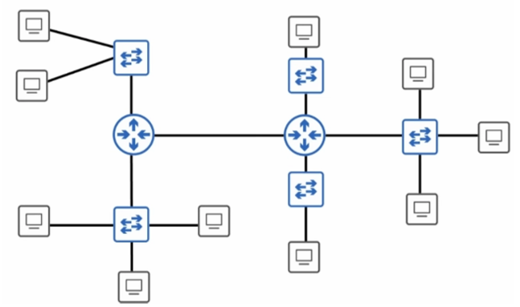
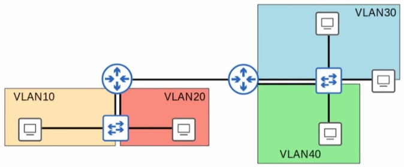
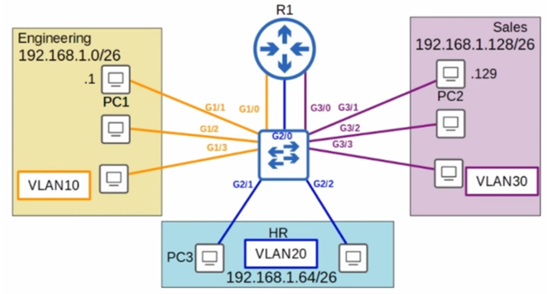

# 🌐 Introduction to VLANs (Virtual Local Area Networks)

> **Course:** CCNA 200-301 | **Source:** Jeremy's IT Lab
**Tags:** #CCNA #Networking #VLANs #Switching
> 

---

## 📡 1. Core Concepts: LANs & Broadcast Domains

### 🏠 LAN (Local Area Network)

> A network that interconnects devices within a **limited area** (home, office, building).
> 

### 📢 Broadcast Domain

> A logical division of a computer network in which **all nodes can reach each other by broadcast** at the data link layer.
> 

| Device | Breaks Up Broadcast Domains? |
| --- | --- |
| **Router** | ✅ **Yes** (each interface = separate domain) |
| **Switch** | ❌ **No** (by default, all ports = one domain) |

> 💡 **Rule of Thumb:** Devices in the same broadcast domain receive each other's broadcast frames (e.g., ARP requests).
> 

---

## 🧩 2. What is a VLAN & Why Use It?

> A **VLAN** is a **logical grouping** of devices on one or more LANs configured to communicate as if they were attached to the same wire — even though they are physically on different LAN segments.
> 

### 🎯 Why Segment the Network with VLANs?

| Benefit | Emoji | Description |
| --- | --- | --- |
| **Security** | 🔒 | Isolate sensitive traffic (e.g., HR vs. Engineering) |
| **Performance** | ⚡ | Reduces broadcast traffic (smaller domains = less noise) |
| **Cost Efficiency** | 💰 | Reduces need for extra hardware (no physical router per subnet) |
| **Flexibility** | 🛠 | Easily move users between groups without changing cabling |

---

## ⚖ 3. Layer 3 vs. Layer 2 Segmentation

| Approach | Method | Device |
| --- | --- | --- |
| **Layer 3 (Subnets)** | Separate networks into different subnets | 🖧 **Router** (traditional method) |
| **Layer 2 (VLANs)** | Segment internally on a single switch | 🔀 **Switch** (creates multiple broadcast domains on one physical switch) |

> 💡 **Key Insight:** VLANs allow you to create **multiple broadcast domains** on a **single physical switch** — no extra hardware required!
> 

---

## 🛠 4. Configuration & Defaults

### 📌 Default Behavior

> **All switch ports belong to VLAN 1** (the Default VLAN) by default.
> 

### 📝 Configuration Commands

#### 🏷️ Create a VLAN (Global Config)

```
vlan [id]
 name [name]
```

*Example:*

```
vlan 10
 name HR
```

#### 🔌 Assign an Interface to a VLAN (Interface Config)

```
interface [type]
 switchport mode access
 switchport access vlan [id]
```

*Example:*

```
interface GigabitEthernet0/1
 switchport mode access
 switchport access vlan 10
```

### 🔍 Verification Commands

```
show vlan brief
```

> Displays all VLANs, their IDs, names, status, and assigned ports.
> 

---

### 🧰 Additional Useful VLAN Syntaxes (Bonus for CCNA)

| Command | Mode | Purpose |
| --- | --- | --- |
| `show vlan id [id]` | Privileged EXEC | Display details for a specific VLAN |
| `show vlan name [name]` | Privileged EXEC | Display details for a specific VLAN by name |
| `show vlan summary` | Privileged EXEC | Display a summary of all VLANs |
| `show interfaces switchport` | Privileged EXEC | Show switchport configuration (access/trunk, VLAN) |
| `show interfaces status` | Privileged EXEC | Show status of all interfaces (VLAN, speed, duplex) |
| `vlan [id] name [name]` | Global Config | Create a VLAN and name it in one line |
| `no vlan [id]` | Global Config | Delete a VLAN |
| `default interface [type]` | Global Config | Reset an interface to default configuration |
| `switchport mode trunk` | Interface Config | Configure a port as a trunk (carries multiple VLANs) |
| `switchport trunk allowed vlan [id]` | Interface Config | Restrict which VLANs can traverse a trunk |
| `show interfaces trunk` | Privileged EXEC | Display trunk port information and allowed VLANs |

---

## 🧠 Quiz Time! (Test Your Knowledge)

### 📝 Text-Based Quizzes

#### ❓ Q1: What happens if you try to assign a switch interface to a VLAN that doesn't exist?

| Option | Answer |
| --- | --- |
| a) The command will fail | ❌ |
| b) The switch will create the VLAN | ✅ |
| c) The interface will be disabled until you create the VLAN | ❌ |
| d) All VLANs exist by default | ❌ |

> **✅ Answer: b) The switch will create the VLAN.**
> 
> 
> 📝 **Note:** In modern Cisco IOS, if you assign a port to a non-existent VLAN, the switch **automatically creates it** in the VLAN database.
> 

---

#### ❓ Q2: You create VLANs 10, 20, and 30 on a Cisco switch. How many VLANs will be displayed in `show vlan brief`?

| Option | Answer |
| --- | --- |
| a) 3 | ❌ |
| b) 5 | ❌ |
| c) 8 | ✅ |
| d) 10 | ❌ |

> **✅ Answer: c) 8**
> 
> 
> **Explanation:**
> 
> - You created: **3 VLANs** (10, 20, 30)
> - Default VLAN: **VLAN 1** → +1
> - Token Ring/FDDI defaults: **VLANs 1002, 1003, 1004, 1005** → +4
> - **Total: 3 + 1 + 4 = 8 VLANs**

---

### 🖼 Diagram Quizzes

#### 🗺️ Quiz Image 1: Basic Network Diagram



**Question:** How many broadcast domains are shown?

> **✅ Answer: 6 Broadcast Domains**
> 

**Explanation:**

- 🔺 **Routers** = circles with arrows → each interface = boundary for broadcast domain
- ⬜ **Switches** = squares with arrows → do NOT break up broadcast domains

Counting distinct segments separated by routers:

1. Top-left switch + its 2 PCs
2. Bottom-left switch + its 3 PCs
3. Point-to-point link between left router and middle router
4. Top-middle switch + its 1 PC
5. Bottom-middle switch + its 1 PC
6. Entire right side (rightmost switch + 3 PCs connected to middle router)

> 💡 **Remember:** All PCs plugged into a single switch (without VLANs) are in the **same broadcast domain**.
> 

---

#### 🎨 Quiz Image 2: VLAN Segmentation



**Question:** Looking at the color-coded sections, how many broadcast domains are shown?

> **✅ Answer: 5 Broadcast Domains**
> 

**Explanation:**

- VLANs logically separate a physical switch into **multiple smaller broadcast domains**
- Router interfaces always bound a broadcast domain

Counting them:

1. 🟡 VLAN10 (Yellow)
2. 🔴 VLAN20 (Red)
3. 🔵 VLAN30 (Blue)
4. 🟢 VLAN40 (Green)
5. Point-to-point link connecting the two routers

---

#### 📡 Quiz Image 3: Broadcast Propagation



**Question:** If PC3 sends a broadcast message, how many devices will receive it?

> **✅ Answer: 3 Devices**
> 

**Explanation:**

- A broadcast message **stays within its specific VLAN/broadcast domain**
- PC3 is in the **HR VLAN20** broadcast domain

Receivers:

1. **Switch** — receives the message from PC3
2. **Other PC** in HR VLAN20 — switch floods broadcast to this device
3. **Router R1** — connected via trunk (blue link) carrying VLAN20 traffic; subinterface for VLAN20 receives the broadcast

> 📝 **Note:** The switch itself also processes the frame to flood it, but in standard CCNA counting, we look at the **sender**, the **end receivers**, and the **router interface**.
> 

---

## 📋 Quick Reference Cheat Sheet

### 🔑 Key Terms

| Term | Definition |
| --- | --- |
| **LAN** | Local Area Network — limited geographic area |
| **Broadcast Domain** | All nodes that receive each other's broadcast frames |
| **VLAN** | Logical grouping of devices that communicate as if on the same wire |
| **Default VLAN** | VLAN 1 — all ports belong here by default |
| **Access Port** | Switch port assigned to a single VLAN |
| **Trunk Port** | Switch port carrying multiple VLANs (802.1Q) |

### 📌 Default VLANs on Cisco Switches

| VLAN ID | Name | Purpose |
| --- | --- | --- |
| **1** | default | Default VLAN (all ports) |
| **1002** | fddi-default | FDDI default |
| **1003** | token-ring-default | Token Ring default |
| **1004** | fddinet-default | FDDI Net default |
| **1005** | trnet-default | Token Ring Net default |

### ⚡ Quick Command Reference

```
! Create VLAN
vlan 10
 name HR

! Assign port to VLAN
interface GigabitEthernet0/1
 switchport mode access
 switchport access vlan 10

! Verify
show vlan brief
show vlan id 10
show interfaces switchport
show interfaces status
```