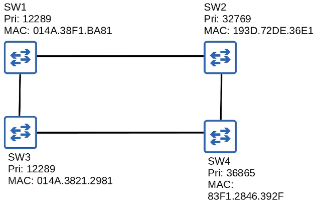
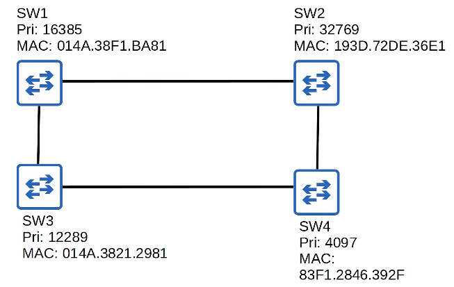
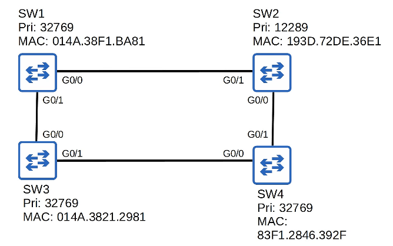
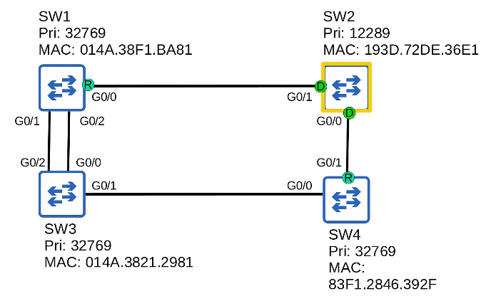
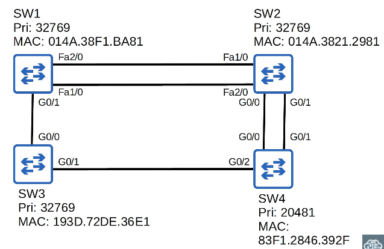

# 🌐 CCNA Notes: Spanning Tree Protocol (STP) - Part 1

## 📡 1. Network Redundancy

- **Why it's essential:** Networks must run 24/7/365. Even short downtime is disastrous. We must implement redundancy at every possible point.
- **Poor Design:** Single points of failure (one cable, one switch, one router) will cut off connectivity.
- **Good Design:** Multiple paths between switches. If one path fails, traffic uses an alternate path.
- **The Catch:** Redundant Layer 2 paths create **loops**, which can destroy your network without a protocol like STP.

## 🚨 2. The Problem: Layer 2 Loops

- **Broadcast Storms:** Switches flood broadcasts/unknown unicasts out all ports. With loops, frames circulate endlessly. Unlike IP (which has TTL), **Ethernet has no TTL field**.
- **MAC Address Flapping:** Frames with the same source MAC arrive on different interfaces continuously. The switch constantly updates its MAC address table, causing instability.
- **The Solution:** STP prevents loops by placing redundant ports into a **blocking state** (acting as a backup).
- *Note on Terminology:* STP still uses the word "Bridge" (e.g., Bridge ID, BPDU). In modern networks, **Bridge = Switch**.

## 🌳 3. Introduction to STP (IEEE 802.1D)

- **BPDUs (Bridge Protocol Data Units):** Switches send Hello BPDUs every **2 seconds** by default to advertise themselves and learn about other switches.
- **Goal:** Create a single, loop-free path to and from each point in the network.
- **Port States:**
    - **Forwarding:** Sends/receives normal traffic.
    - **Blocking:** Only sends/receives BPDUs.

## 🆔 4. The Bridge ID (BID)

- Used to elect the Root Bridge. Lowest BID wins.
- **Traditional BID (8 Bytes / 64 bits):**
    - Bridge Priority (16 bits): Default = `32768`
    - MAC Address (48 bits): Used as tiebreaker.
- **Updated BID (Cisco PVST+):**
    - Bridge Priority (4 bits)
    - Extended System ID (12 bits): The **VLAN ID**.
    - MAC Address (48 bits).
    - *Key Fact:* Because VLAN 1 is default, the default priority in VLAN 1 is `32768 + 1 = **32769`**.
    - *Configuration Rule:* Priority can only be changed in increments of **4096**.

## 👑 5. STP Election Process

### Step 1: Elect the Root Bridge

- **Rule:** Lowest Bridge ID wins.
- **Result:** ALL ports on the Root Bridge become **Designated (D)** and are in a **Forwarding** state.
- *Note:* Once converged, only the Root Bridge generates BPDUs. Other switches forward them.

### Step 2: Elect Root Ports (R)

- **Rule:** Every *non-root* switch selects exactly ONE Root Port.
- **Criteria:** Lowest **Root Cost** (cost of outgoing interfaces to reach the root).
    - **STP Costs:** 10 Mbps = 100 | 100 Mbps (FastEthernet) = 19 | 1 Gbps (Gigabit) = 4 | 10 Gbps = 2.
- **Tiebreakers (if Root Cost is tied):**
    1. Lowest **Neighbor Bridge ID** (MAC address).
    2. Lowest **Neighbor Port ID** (e.g., G0/0 is lower than G0/1). *Note: It is the neighbor's port ID, not the local switch's.*
- **Result:** Root Ports are in a **Forwarding** state. The port directly connected to a Root Port is always a Designated Port.

### Step 3: Elect Designated Ports (D)

- **Rule:** Every collision domain (segment) must have exactly ONE Designated Port.
- **Criteria:** The switch with the lowest **Root Cost** wins the segment.
- **Tiebreaker:** Lowest **Bridge ID**.
- **Result:** The winning port is **Designated** (Forwarding). The losing port becomes **Non-Designated (N)** and goes into a **Blocking** state.

---

## 🧠 6. Practice Quizzes Recap

**Quiz 1 & 2: Root Bridge Election**

Day 11-2 STP Quiz 1

Day 11-2 STP Quiz 2

- *Scenario:* 4 switches with varying priorities.
- *Logic:* Always look for the lowest Priority first. If tied, look at the lowest MAC address.
- *Answer:* SW3 won in Quiz 1 (MAC tiebreaker). SW4 won in Quiz 2 (Lowest priority: 4097).

**Quiz 3: Root Port Tiebreaker (Neighbor BID)**

Day 11-2 STP Quiz 3

- *Scenario:* SW3 has equal cost paths to the root via SW1 and SW4.
- *Logic:* Tiebreaker is the Neighbor Bridge ID. SW1 has a lower MAC than SW4.
- *Answer:* SW3 selects the port connected to SW1 (G0/0).

**Quiz 4: Root Port Tiebreaker (Neighbor Port ID)**

Day 11-2 STP Quiz 4

- *Scenario:* Parallel links between SW1 and SW3.
- *Logic:* Root cost is tied. Neighbor BID is tied. Look at the *neighbor's* port ID. SW1's G0/0 is lower than G0/1.
- *Answer:* SW3 selects its port connected to SW1's G0/0 (which is G0/2).

**Quiz 5: Complex Topology**

Day 11-2 STP Quiz 5

- *Answer:* **SW3 is Root** (lowest MAC). SW2's **G0/2** is its Root Port because it connects to SW1's lower port ID (G0/0). SW2's other ports are Non-Designated because SW2 has a higher root cost to the network than its neighbors.

**Quiz 6: Mixed Speeds**

Day 11-2 STP Quiz 6

- *Answer:* **SW4 is Root** (lowest priority). **SW1's G0/1** is its Root Port because its other links are FastEthernet (cost 19) which is worse than Gigabit (cost 4). SW2's G0/1 is Non-Designated because SW4 is the Root Bridge (its ports are automatically Designated).

---

## 💡 7. Boson ExSim Bonus Question (PortFast)

**Question:** You want to decrease the amount of time it takes for switchports on SwitchA to begin forwarding. PortFast is not configured. You issue the `spanning-tree portfast default` command from global configuration mode. Which ports will use PortFast?

- A. No ports, because PortFast cannot be enabled globally.
- B. All ports.
- C. All access ports.
- D. All trunk ports.

**Answer:** **C. All access ports.**

- **Why?** The global command `spanning-tree portfast default` automatically enables PortFast on all access (edge) ports. It **does not** apply to trunk ports. Trunk ports require the specific interface command `spanning-tree portfast trunk`.