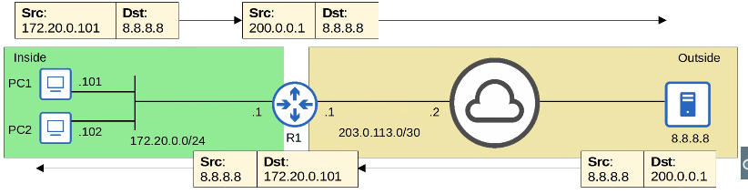

# 🌐 CCNA Notes: NAT & Private IP Addressing

#### 📜 Private IPv4 Addresses (RFC 1918)

These addresses are for internal use only and are not globally unique. They cannot be routed over the internet.

- **Class A:** `10.0.0.0/8` (Range: `10.0.0.0` - `10.255.255.255`)
- **Class B:** `172.16.0.0/12` (Range: `172.16.0.0` - `172.31.255.255`)
- **Class C:** `192.168.0.0/16` (Range: `192.168.0.0` - `192.168.255.255`)

#### 🎯 NAT (Network Address Translation) Overview

- **Purpose:** To modify the source and/or destination IP address of packets. The most common use is to allow hosts with private IP addresses to communicate over the internet.
- **Source NAT:** Translates the **source** IP address of outgoing packets.
- **Benefit:** Conserves public IPv4 addresses by allowing multiple internal hosts to share one or more public IP addresses.

#### 🔑 Key NAT Terminology

Understanding these terms is crucial for all NAT types.

- **Inside:** Refers to the internal network (e.g., your home or company LAN).
- **Outside:** Refers to the external network (e.g., the Internet).
- **Local:** The perspective of the **inside** network.
- **Global:** The perspective of the **outside** network.

| Term | Definition | Example (from video) |
| --- | --- | --- |
| **Inside Local** | The actual IP address configured on an inside host. Usually a private IP. | PC1's IP: `192.168.0.167` |
| **Inside Global** | The IP address of an inside host as it appears to the outside world after NAT. Usually a public IP. | PC1's NAT IP: `100.0.0.1` |
| **Outside Local** | The IP address of an outside host as it appears to the inside network. | Server's IP: `8.8.8.8` |
| **Outside Global** | The actual IP address of an outside host on the internet. | Server's IP: `8.8.8.8` |

*Note: Outside Local and Outside Global are typically the same unless Destination NAT is used (which is beyond CCNA scope).*

#### 🔧 Static NAT

- **Function:** Creates a permanent **one-to-one** mapping between an Inside Local IP and an Inside Global IP.
- **Use Case:** Allows an internal device to be consistently reachable from the outside.
- **Limitation:** Does not conserve IP addresses, as each internal device requires its own dedicated public IP.

---

### 💻 Configuration Syntax

#### Interface Configuration

These commands are executed in **interface configuration mode** (`(config-if)#`).

```
ip nat inside
ip nat outside
```

- **`ip nat inside`** : Applied to the router's interface connected to the internal network. Designates it as the "inside" of the NAT.
- **`ip nat outside`** : Applied to the router's interface connected to the external network (e.g., the Internet). Designates it as the "outside" of the NAT.

#### Global Configuration

This command is executed in **global configuration mode** (`(config)#`).

```
ip nat inside source static <inside-local-ip> <inside-global-ip>
```

- **Function:** Creates a static one-to-one mapping. It tells the router to translate the `<inside-local-ip>` to the `<inside-global-ip>` for all traffic entering the inside interface and exiting the outside interface.
- **Example:** `ip nat inside source static 192.168.0.167 100.0.0.1`

---

### 🔍 Verification & Management Commands

These commands are executed in **privileged EXEC mode** (`#`).

- **`show ip nat translations`**
    - Displays the NAT translation table. Shows both permanent static entries and dynamic entries created by traffic flow.
- **`show ip nat statistics`**
    - Provides a summary of NAT operations, including the total number of active translations, the number of static vs. dynamic entries, and which interfaces are configured as inside/outside.
- **`clear ip nat translation *`**
    - Clears all **dynamic** translations from the NAT table. Static translations are permanent and are not removed by this command.

---

### 📝 CCNA NAT Quiz Reference

**Quiz 1Q:** Which command configures a static source NAT mapping of `192.168.10.10` to `203.0.113.10`?
**A:** `ip nat inside source static 192.168.10.10 203.0.113.10` — maps the inside local address to the inside global address.

**Quiz 2Q:** You configured `ip nat inside source static 10.0.0.1 20.0.0.1`. What happens when you issue `ip nat inside source static 10.0.0.2 20.0.0.1`?
**A:** Only `10.0.0.1` will be translated to `20.0.0.1`. The second command is rejected because the same public IP cannot be mapped to another private IP with static NAT.

**Quiz 3Q:** After issuing `clear ip nat translation *`, how many active translations remain if there are 3 static translations and some dynamic entries?
**A:** 3. The command clears only dynamic translations; static translations remain.

**Quiz 4Q:** Which are private IPv4 addresses? (Select all that apply.)
**A:** `10.254.255.0`, `172.20.2.3`, and `10.11.12.13`. These fall within RFC 1918 ranges: `10.0.0.0/8`, `172.16.0.0/12`, and `192.168.0.0/16`.

**Quiz 5Q:** PC1 pings `8.8.8.8`. From R1’s perspective, identify the outside global, outside local, inside local, and inside global addresses. Which appear in `show ip nat translations`?



- Outside global: `8.8.8.8`
- Outside local: `8.8.8.8`
- Inside local: `172.20.0.101`
- Inside global: `200.0.0.1`

Outside local and outside global are the same unless destination NAT is used, which is beyond CCNA scope.

**Bonus Quiz:** HostA establishes a TFTP connection with HostB. Based on `show ip nat translations` output, what is HostA’s IP address?
**A:** `10.20.30.55`. TFTP uses UDP and destination port 69, identifying the correct entry. The question asks for HostA’s actual IP address, so the answer is the inside local address, not the inside global NAT address.