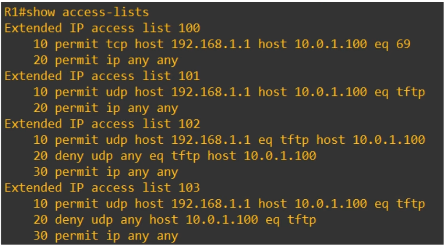
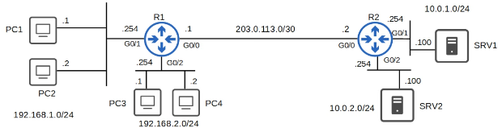
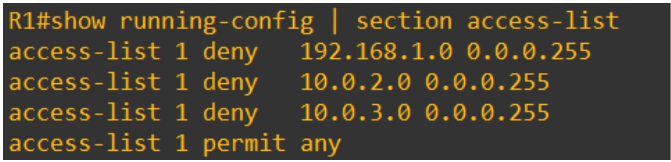
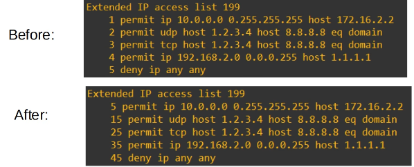
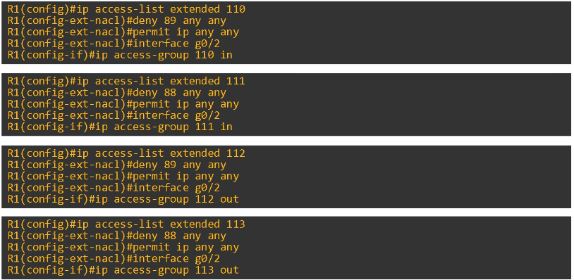
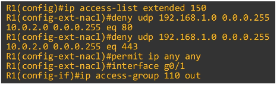

# 📚 CCNA Day 35: Extended ACLs - Complete Course Notes

## 🎯 Overview

Extended ACLs provide more granular traffic control than standard ACLs by matching on multiple parameters including protocol, source/destination IP, and port numbers.

---

## 📋 Key Concepts

### 🔄 ACL Configuration Methods

- **Traditional Method**: Configure numbered ACLs from global config mode
- **Named Method**: Configure ACLs (numbered or named) from named ACL config mode
- **Advantage**: Named config mode allows editing individual entries and inserting entries with specific sequence numbers

### ✏️ ACL Editing Capabilities

| Method | Delete Individual Entries | Insert Entries Mid-ACL | Specify Sequence Numbers |
| --- | --- | --- | --- |
| Global Config (Traditional) | ❌ (Deletes entire ACL) | ❌ | ❌ |
| Named ACL Config | ✅ | ✅ | ✅ |

### 🔢 Resequencing ACLs

- Function: Renumbers ACL entries to create space for future insertions
- Works for: All ACL types (numbered/named, standard/extended)
- Executed from: Global config mode

---

## 📖 Extended ACLs

### 🔢 Number Ranges

| Type | Range |
| --- | --- |
| Standard ACL | 1-99, 1300-1999 |
| Extended ACL | 100-199, 2000-2699 |

### 🎛️ Matching Parameters

Extended ACLs can match based on:

- **Layer 4 Protocol**: TCP, UDP, ICMP, IP (all protocols)
- **Source IP Address**: With wildcard mask or HOST keyword
- **Destination IP Address**: With wildcard mask or HOST keyword
- **Source/Destination Port Numbers**: EQ, GT, LT, NEQ, RANGE

### 🔌 Common Port Numbers

| Port | Service |
| --- | --- |
| 20/21 | FTP |
| 22 | SSH |
| 23 | Telnet |
| 25 | SMTP |
| 53 | DNS |
| 69 | TFTP |
| 80 | HTTP |
| 443 | HTTPS |

### 📊 Protocol Numbers

| Number | Protocol |
| --- | --- |
| 1 | ICMP |
| 6 | TCP |
| 17 | UDP |
| 88 | EIGRP |
| 89 | OSPF |

### 🔍 Port Matching Options

| Option | Meaning | Example |
| --- | --- | --- |
| EQ | Equal to | EQ 80 (port 80 only) |
| GT | Greater than | GT 80 (81 and above) |
| LT | Less than | LT 80 (79 and below) |
| NEQ | Not equal | NEQ 80 (all except 80) |
| RANGE | Range | RANGE 80 100 (80-100) |

### 📍 Application Rules

| ACL Type | Application Location |
| --- | --- |
| Standard | Close to destination |
| Extended | Close to source |

---

## 💻 Syntax Reference

### Configuration Commands

| Syntax | Description | Mode |
| --- | --- | --- |
| `access-list <number> {permit\|deny} <protocol> <source> <destination>` | Configure numbered ACL entry (traditional) | Global Config |
| `ip access-list standard <number\|name>` | Enter standard named ACL config mode | Global Config |
| `ip access-list extended <number\|name>` | Enter extended named ACL config mode | Global Config |
| `{permit\|deny} <protocol> <source> <destination>` | Configure ACL entry | Named ACL Config |
| `<sequence_number> {permit\|deny} <protocol> <source> <destination>` | Configure entry with specific sequence number | Named ACL Config |
| `no <sequence_number>` | Delete specific ACL entry | Named ACL Config |
| `ip access-list resequence <name\|number> <start> <increment>` | Renumber ACL entries | Global Config |

### Interface Application Commands

| Syntax | Description | Mode |
| --- | --- | --- |
| `ip access-group <name\|number> {in\|out}` | Apply ACL to interface | Interface Config |

### Verification Commands

| Syntax | Description | Mode |
| --- | --- | --- |
| `show access-lists` | Display all ACLs | Privileged EXEC |
| `show ip interface <interface>` | Show ACLs applied to interface | Privileged EXEC |
| `show running-config` | Display current configuration | Privileged EXEC |

### Extended ACL Entry Syntax

```
{permit|deny} <protocol> <source> [<source_port>] <destination> [<destination_port>]
```

**Examples:**

```
permit ip any any
deny tcp 192.168.1.0 0.0.0.255 host 10.0.1.100 eq 443
deny udp any range 20000 30000 host 3.3.3.3
permit tcp 172.16.1.0 0.0.0.255 gt 9999 host 4.4.4.4 neq 23
```

### Specifying Hosts and Networks

| Method | Syntax | Example |
| --- | --- | --- |
| Single Host | `host <ip>` or `<ip> 0.0.0.0` | `host 192.168.1.1` |
| Network | `<network> <wildcard>` | `192.168.1.0 0.0.0.255` |
| Any | `any` | `any` |

---

## 📝 Quiz

### Question 1

**Which ACL, when applied outbound on R1's G0/0, permits only PC1 to access the TFTP server on SRV1?**





### Question 2

**What effect will the command `no access-list 1 deny 10.0.2.0 0.0.0.255` have on ACL 1?**



- A) Traffic from 10.0.2.0/24 will be permitted
- B) ACL 1 will be deleted
- C) The command will not work, it will be rejected
- D) Traffic to 10.0.2.0/24 will be permitted

### Question 3

**Which command was used to resequence ACL 199 from (1, 2, 3, 4, 5) to (5, 15, 25, 35, 45)?**



### Question 4

**Which ACL would prevent R1 from forwarding OSPF packets out of G0/2?**



### Question 5

**ACL 150 isn't having the intended effect. How can it be fixed to deny HTTP and HTTPS traffic from 192.168.1.0/24 to 10.0.2.0/24, but allow other traffic? (Select two)**




- A) Swap the source and destination IPs
- B) Move the `permit ip any any` statement to the beginning of the ACL
- C) Apply the ACL inbound on G0/1, not outbound
- D) Apply the ACL inbound on G0/0, not G0/1
- E) The protocol should be TCP, not UDP
- F) The port numbers should be 88 and 404

---

## ✅ Quiz Answers

1. **ACL 103** - Entry 10 permits UDP from PC1 to port 69 (TFTP) on SRV1; Entry 20 denies other hosts; Entry 30 permits all other traffic.
2. **B) ACL 1 will be deleted** - Using `no` with a specific entry in global config mode deletes the entire ACL, not just that entry.
3. **`ip access-list resequence 199 5 10`** - Starts at 5, increments by 10: (5, 15, 25, 35, 45).
4. **ACL 112** - Protocol number 89 is OSPF (88 is EIGRP).
5. **C and E** - Apply inbound on G0/1 (to filter traffic entering from 192.168.1.0/24), and HTTP/HTTPS use TCP, not UDP.

---

## 💡 Key Takeaways

- ✅ Extended ACLs match on protocol, source/destination IP, and ports
- ✅ Use named ACL config mode for easier editing
- ✅ Use `ip access-list resequence` to renumber entries
- ✅ Apply extended ACLs close to the source
- ✅ Remember protocol numbers: ICMP=1, TCP=6, UDP=17, EIGRP=88, OSPF=89
- ✅ Use `host` or `0.0.0.0` wildcard for /32 addresses in extended ACLs
- ✅ Verify with `show access-lists` and `show ip interface`