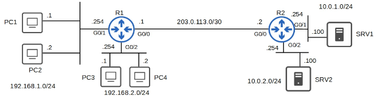
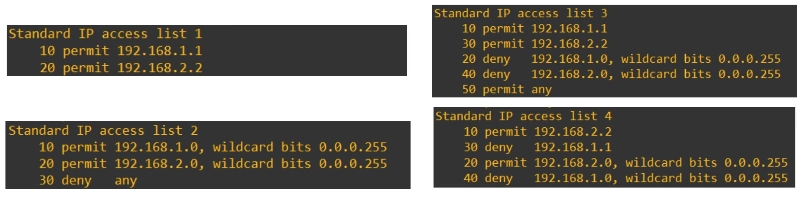
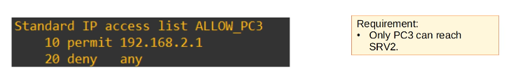
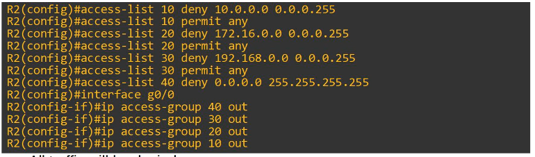
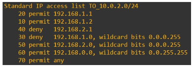

# 📚 Day 34 — Standard ACLs (CCNA 200-301)

## 🎯 Lesson Scope

- **Topic:** Standard Access Control Lists (ACLs)
- **Exam topic:** 5.6 — Configure and verify access control lists
- **Focus:** IPv4 standard ACLs: **numbered** and **named**
- **Extended ACLs:** covered in Day 35

---

## 🔐 What Are ACLs?

- ACL = **packet filter** telling the router to **permit** or **deny** traffic.
- Main security use: control which devices can access which network parts.
- Can filter by source/destination IP and Layer 4 ports; CCNA focus = IP + ports.
- Router may have a route, but ACL can still cause the packet to be dropped.

---

## ⚙️ ACL Logic & Processing

- ACLs are configured **globally**, but only take effect when **applied to an interface**.
- Applied **inbound** or **outbound**.
- Processed **top to bottom**.
- **First match wins**; remaining entries are ignored.
- **Implicit deny** exists at the end of every ACL: unmatched traffic is dropped.
- **Standard ACL best practice:** apply as close to the **destination** as possible.
- Max **one ACL per interface per direction**.
- Applying another ACL in the same direction **replaces** the previous one.

---

## 🧱 Standard Numbered ACLs

- Match **source IP only**.
- Valid numbers: **1–99** and **1300–1999**.

### Basic Syntax

```
ACCESS-LIST {1-99 | 1300-1999} {PERMIT | DENY} {IP} {WILDCARD}
```

### Examples

```
! Deny one host — equivalent forms
ACCESS-LIST 1 DENY 1.1.1.1 0.0.0.0
ACCESS-LIST 1 DENY 1.1.1.1
ACCESS-LIST 1 DENY HOST 1.1.1.1

! Permit any — equivalent forms
ACCESS-LIST 1 PERMIT ANY
ACCESS-LIST 1 PERMIT 0.0.0.0 255.255.255.255

! Deny a /24 subnet
ACCESS-LIST 1 DENY 192.168.1.0 0.0.0.255

! Add remark
ACCESS-LIST 1 REMARK ## Block PC1 ##
```

### Apply to Interface

```
INTERFACE {interface}
IP ACCESS-GROUP {number} {IN | OUT}
```

---

## 🏷️ Standard Named ACLs

- Still standard ACLs: match **source IP only**.
- Identified by **name**, not number.
- Configured in **standard named ACL config mode**.

### Enter Mode

```
IP ACCESS-LIST STANDARD {name}
```

### Configure Entries

```
{optional-sequence-number} {PERMIT | DENY} {IP} {WILDCARD}
REMARK {text}
```

### Example

```
IP ACCESS-LIST STANDARD BLOCK_BOB
5 DENY HOST 1.1.1.1
10 PERMIT ANY
REMARK ## Block Bob's PC ##
EXIT

INTERFACE G0/0
IP ACCESS-GROUP BLOCK_BOB OUT
```

---

## 🧾 Syntax Enumeration

### Global Configuration Mode

| Syntax | Description | Lesson Introduced |
| --- | --- | --- |
| `ACCESS-LIST {1-99 | 1300-1999} {PERMIT | DENY} {IP} {WILDCARD}` | Creates a standard numbered ACL entry | Standard Numbered ACLs |
| `ACCESS-LIST {number} REMARK {text}` | Adds a description/remark to a numbered ACL | Standard Numbered ACLs |
| `IP ACCESS-LIST STANDARD {name}` | Creates/enters standard named ACL config mode | Standard Named ACLs |

### Standard Named ACL Configuration Mode

| Syntax | Description | Lesson Introduced |
| --- | --- | --- |
| `{sequence-number} {PERMIT | DENY} {IP} {WILDCARD}` | Configures named ACL entry; sequence number optional | Standard Named ACLs |
| `REMARK {text}` | Adds a description/remark to a named ACL | Standard Named ACLs |

### Interface Configuration Mode

| Syntax | Description | Lesson Introduced |
| --- | --- | --- |
| `IP ACCESS-GROUP {number | name} {IN | OUT}` | Applies ACL to interface in specified direction | Standard Numbered & Named ACLs |

### Privileged EXEC Mode — Verification

| Syntax | Description | Lesson Introduced |
| --- | --- | --- |
| `SHOW ACCESS-LISTS` | Displays all ACLs on the router | Standard Numbered ACLs |
| `SHOW IP ACCESS-LISTS` | Displays only IP ACLs | Standard Numbered ACLs |
| `SHOW RUNNING-CONFIG | INCLUDE ACCESS-LIST` | Filters running config for ACL-related lines | Standard Numbered ACLs |
| `SHOW RUNNING-CONFIG | SECTION ACCESS-LIST` | Displays the full ACL section of running config | Standard Named ACLs |

### Wildcard Syntax Quick Reference

| Match | IP + Wildcard | Shortcut |
| --- | --- | --- |
| Single host /32 | `1.1.1.1 0.0.0.0` | `HOST 1.1.1.1` or just `1.1.1.1` |
| Any address | `0.0.0.0 255.255.255.255` | `ANY` |
| /24 subnet | `192.168.1.0 0.0.0.255` | N/A |

---

## 📝 Quiz



### Question 1

Which ACL, when applied outbound on R2’s G0/1, permits only PC1 and PC4 to access 10.0.1.0/24?



**Answer:** ACL 1 — entry 10 permits PC1, entry 20 permits PC4; implicit deny blocks the rest.

---

### Question 2

Which interface should the ACL be applied to, and in which direction, to control access to 10.0.2.0/24?



**Answer:** R2’s **G0/2**, **outbound**. Standard ACLs should be placed close to the destination.

---

### Question 3

You issue commands on R2 and apply multiple ACLs to the same interface/direction. Which statement is correct?



**Answer:** Traffic from **10.0.0.0/24** will be denied — the last ACL applied in that direction replaces the previous one.

---

### Question 4

If an ACL is applied inbound on R1 G0/0, which PCs will be able to ping SRV2?



**Answer:** **All PCs** — return traffic from SRV2 matches `permit any`; the ACL does not block the outbound ping path.

---

### Question 5

What happens if a packet doesn’t match any entries of an ACL?

**Answer:** The packet is **dropped** because of the **implicit deny** at the end of every ACL.

---

### 🎁 Bonus Question — Boson ExSim

Which statement is true regarding ACLs?

A) ACLs are processed from least specific to most specific

B) ACLs are processed from first entry to last entry

C) ACLs are processed from last entry to first entry

D) ACLs are processed from most specific to least specific

**Answer:** **B) ACLs are processed from first entry to last entry** — top to bottom.