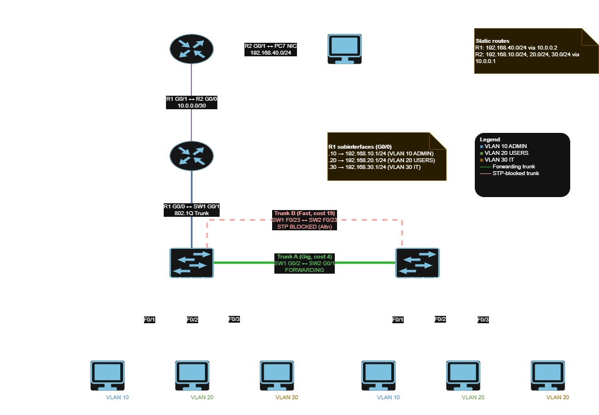

# Capstone-Lite: VLAN, STP & Static Routing Lab

A documented Cisco Packet Tracer lab demonstrating core enterprise networking concepts: Layer 2 segmentation, redundancy, inter-VLAN routing, and remote site connectivity.


## 🗺️ Network Topology



> Editable source: [`diagrams/topology.drawio`](diagrams/topology.drawio) (open with [diagrams.net](https://app.diagrams.net)).

## 📝 Project Overview

This project simulates a small campus network connected to a remote branch. It focuses on building a resilient Layer 2 core and routing traffic between segmented VLANs and an external network.

The build is split into two stages:

- **Stage 1 (Campus core):** two switches, three VLANs, redundant trunks with STP, and router-on-a-stick on R1.
- **Stage 2 (Remote site):** a second router (R2) and a remote LAN, joined to the campus by static routes in both directions.

**Key Technologies Implemented:**

*   **VLANs:** 3 VLANs (ADMIN, USERS, IT) for broadcast domain segmentation.
*   **802.1Q Trunking:** Carrying multiple VLANs over a single physical link.
*   **Spanning Tree Protocol (PVST):** Manual root bridge election and redundant link failover (FastEthernet blocks, Gigabit forwards).
*   **Router-on-a-Stick (ROAS):** Inter-VLAN routing using subinterfaces on a single router interface.
*   **Static Routing:** Bidirectional routing between the campus core (R1) and a remote site (R2).

## 🧰 Devices

| Device | Model | Role |
| :--- | :--- | :--- |
| R1 | Cisco 1941 | Router-on-a-stick for VLANs 10/20/30; campus-side link to R2 |
| R2 | Cisco 1941 | Remote branch router |
| SW1 | Cisco 2960 | STP root bridge (`root primary`) |
| SW2 | Cisco 2960 | Secondary root (`root secondary`) |
| PC1-PC6 | PC | Campus hosts, 3 per switch (one per VLAN) |
| PC7 | PC | Remote host behind R2 |

## 📊 IP Addressing Plan

| VLAN | Name | Subnet | Gateway | Devices |
| :--- | :--- | :--- | :--- | :--- |
| 10 | ADMIN | 192.168.10.0/24 | 192.168.10.1 | PC1, PC4 |
| 20 | USERS | 192.168.20.0/24 | 192.168.20.1 | PC2, PC5 |
| 30 | IT | 192.168.30.0/24 | 192.168.30.1 | PC3, PC6 |
| **Transit** | **R1-R2 Link** | **10.0.0.0/30** | **10.0.0.1/10.0.0.2** | **R1, R2** |
| **Remote** | **Branch** | **192.168.40.0/24** | **192.168.40.1** | **PC7** |

**Host addresses:** PC1 `.10.10`, PC2 `.20.10`, PC3 `.30.10`, PC4 `.10.11`, PC5 `.20.11`, PC6 `.30.11` (all /24), PC7 `192.168.40.10/24`.

*(For full port assignments and routing tables, see [`docs/ip-plan.md`](docs/ip-plan.md))*

## 🔌 Key Links

| Link | Ports | Type | Notes |
| :--- | :--- | :--- | :--- |
| R1 ↔ SW1 | R1 G0/0 ↔ SW1 G0/1 | 802.1Q trunk | ROAS subinterfaces `.10`, `.20`, `.30` |
| SW1 ↔ SW2 (Trunk A) | SW1 G0/2 ↔ SW2 G0/1 | Gigabit trunk | **Forwarding** (STP cost 4) |
| SW1 ↔ SW2 (Trunk B) | SW1 F0/23 ↔ SW2 F0/23 | FastEthernet trunk | **Blocked** by STP (cost 19), hot standby |
| R1 ↔ R2 | R1 G0/1 ↔ R2 G0/0 | Routed, 10.0.0.0/30 | Static routes both ways |
| R2 ↔ PC7 | R2 G0/1 ↔ PC7 NIC | Routed, 192.168.40.0/24 | Remote LAN |

Access ports on both switches: F0/1 → VLAN 10, F0/2 → VLAN 20, F0/3 → VLAN 30 (PortFast enabled).

## 🧭 Static Routes

| Router | Destination | Next hop |
| :--- | :--- | :--- |
| R1 | 192.168.40.0/24 | 10.0.0.2 |
| R2 | 192.168.10.0/24 | 10.0.0.1 |
| R2 | 192.168.20.0/24 | 10.0.0.1 |
| R2 | 192.168.30.0/24 | 10.0.0.1 |

Routes must exist in **both** directions: R1 needs a path to the remote LAN, and R2 needs a way to return traffic to the campus VLANs.

## ✅ What Was Tested

| # | From | To | Proves |
| :--- | :--- | :--- | :--- |
| 1 | PC1 | 192.168.10.1 (gateway) | Default gateway reachable |
| 2 | PC1 | PC4 (192.168.10.11) | Same VLAN across switches (Trunk A works) |
| 3 | PC1 | PC2 (192.168.20.10) | Inter-VLAN routing (ROAS) |
| 4 | PC1 | PC3 (192.168.30.10) | Inter-VLAN routing |
| 5 | PC4 | PC2 (192.168.20.10) | Cross-switch + inter-VLAN |
| 6 | PC6 | PC1 (192.168.10.10) | Full end-to-end |
| 7 | PC1 | PC7 (192.168.40.10) | Campus → remote site |
| 8 | PC7 | PC1 (192.168.10.10) | Remote site → campus |

Also verified: `tracert` from PC1 to PC7 shows the path `192.168.10.1 → 10.0.0.2 → 192.168.40.10`.

**STP failover test:** with a continuous ping running between PC1 and PC4, the Gigabit trunk (SW1 G0/2 ↔ SW2 G0/1) was disconnected. The ping recovered after a short convergence (~30-50 seconds) as F0/23 moved from Blocking to Forwarding. After reconnecting the Gigabit cable, F0/23 returned to Blocking.

Full output and screenshots: [`docs/verification.md`](docs/verification.md).

## 📂 Repository Structure

```
.
├── artifacts/          # Packet Tracer file (capstone-lite.pkt)
├── configs/            # R1, R2, SW1, SW2 configurations
├── diagrams/           # topology.png + editable topology.drawio
├── docs/
│   ├── ip-plan.md
│   ├── verification.md
│   ├── design-decisions.md
│   └── troubleshooting-log.md
└── README.md
```

*   **[`artifacts/`](artifacts/):** The complete Cisco Packet Tracer file (`.pkt`).
*   **[`configs/`](configs/):** Sanitized running configurations for R1, R2, SW1, and SW2.
*   **[`diagrams/`](diagrams/):** Topology image and the editable draw.io source.
*   **[`docs/`](docs/):**
    *   [`ip-plan.md`](docs/ip-plan.md): Full port assignments and routing tables.
    *   [`verification.md`](docs/verification.md): Proof of connectivity, show commands, and failover tests.
    *   [`design-decisions.md`](docs/design-decisions.md): The "why" behind STP root placement, ROAS, and static routes.
    *   [`troubleshooting-log.md`](docs/troubleshooting-log.md): Issues encountered and resolved during the build.

## 🚀 How to Reproduce

1. Open the [`capstone-lite.pkt`](artifacts/capstone-lite.pkt) file in Cisco Packet Tracer.
2. Allow 30-60 seconds for STP to converge (link lights will turn green).
3. From **PC1**, run `ping 192.168.40.10` (PC7). The ping should succeed, verifying the full path from the campus VLAN to the remote site.
4. Review the [`docs/verification.md`](docs/verification.md) file for expected CLI output and test results.

**Handy verification commands**

```
! Switches
show vlan brief
show interfaces trunk
show spanning-tree vlan 10

! Routers
show ip interface brief
show ip route
```

On SW2, `show spanning-tree vlan 10` should show G0/1 as Root/Forwarding and F0/23 as Altn/Blocking.

## 🧠 Key Takeaways

1. **Why VLANs?** Segmentation, security, and smaller broadcast domains.
2. **Why trunks carry multiple VLANs:** One physical link carries many logical networks; 802.1Q tags tell the frames apart.
3. **How ROAS routes between VLANs:** One trunked router interface with a subinterface per VLAN (`encapsulation dot1Q <vlan>`); each subinterface IP is that VLAN's gateway.
4. **Why STP blocks a redundant link:** To prevent Layer 2 loops (broadcast storms, MAC flapping). The blocked link stays as a hot standby.
5. **How static routes enable remote communication:** Each router is told the next hop for networks it isn't directly connected to, in both directions.

## 🛠️ Tools

- Cisco Packet Tracer
- draw.io / diagrams.net (topology diagram)