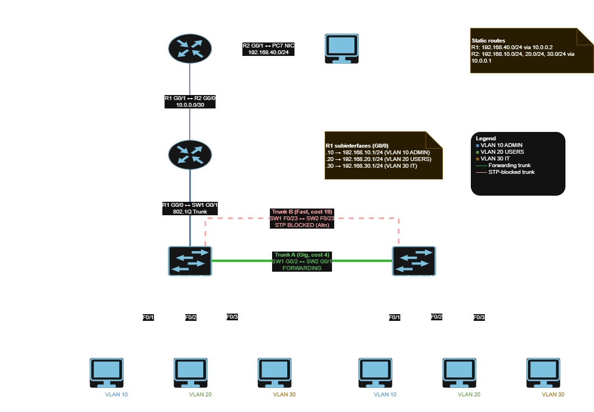
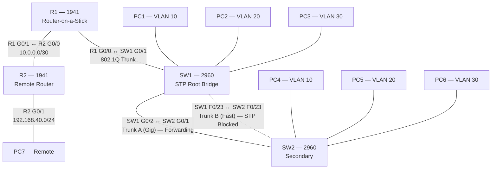

# Topology — Capstone-Lite

## Diagram

*Editable source: `diagrams/topology.drawio`*

## Device Inventory

| Device | Model    | Role                                  |
|--------|----------|---------------------------------------|
| R1     | Cisco 1941 | Router-on-a-stick; inter-VLAN gateway |
| R2     | Cisco 1941 | Remote router; static routing         |
| SW1    | Cisco 2960 | Access switch; STP root bridge       |
| SW2    | Cisco 2960 | Access switch; STP secondary         |
| PC1–PC7| —        | End hosts                             |

## Links

| From      | Port  | To        | Port  | Cable            | Type            |
|-----------|-------|-----------|-------|------------------|-----------------|
| R1        | G0/0  | SW1       | G0/1  | straight-through | 802.1Q trunk    |
| SW1       | G0/2  | SW2       | G0/1  | crossover        | Trunk A (Gig)   |
| SW1       | F0/23 | SW2       | F0/23 | crossover        | Trunk B (Fast)  |
| R1        | G0/1  | R2        | G0/0  | crossover        | Routed /30      |
| R2        | G0/1  | PC7       | NIC   | straight-through | Access          |
| SW1       | F0/1  | PC1       | NIC   | straight-through | Access, VLAN 10 |
| SW1       | F0/2  | PC2       | NIC   | straight-through | Access, VLAN 20 |
| SW1       | F0/3  | PC3       | NIC   | straight-through | Access, VLAN 30 |
| SW2       | F0/1  | PC4       | NIC   | straight-through | Access, VLAN 10 |
| SW2       | F0/2  | PC5       | NIC   | straight-through | Access, VLAN 20 |
| SW2       | F0/3  | PC6       | NIC   | straight-through | Access, VLAN 30 |

## Port Usage

| Device | Gig ports available | Used                              | Status       |
|--------|---------------------|-----------------------------------|--------------|
| R1     | G0/0, G0/1          | G0/0 (SW1), G0/1 (R2)             | both used    |
| R2     | G0/0, G0/1          | G0/0 (R1), G0/1 (PC7)             | both used    |
| SW1    | G0/1, G0/2          | G0/1 (R1), G0/2 (SW2)             | both used    |
| SW2    | G0/1, G0/2          | G0/1 (SW1)                        | G0/2 free    |

## Layer 2 Design

- **Access ports:** F0/1–F0/3 on each switch, PortFast enabled (end hosts, no loop risk).
- **Trunk links:** 802.1Q, allowed VLANs restricted to `10,20,30`.
- **Redundancy:** two inter-switch links (Gig + Fast) form a physical loop;
  STP breaks the loop by blocking the lower-cost-worse path.
- **STP mode:** PVST (per-VLAN), so each VLAN gets its own root/blocking decision.

## Layer 3 Design

- **Inter-VLAN routing:** R1 subinterfaces G0/0.10/.20/.30, one per VLAN.
- **Transit:** 10.0.0.0/30 between R1 and R2.
- **Remote reachability:** static routes in both directions
  (R1 → 192.168.40.0/24, R2 → the three campus VLANs).