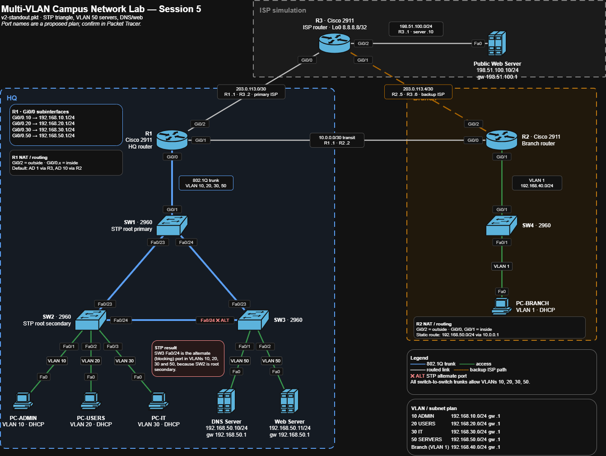

# Multi-VLAN Campus Network Lab

A dual-site enterprise network simulation built in Cisco Packet Tracer: an HQ with four VLANs and a redundant switch triangle, a branch site, and a simulated ISP with a primary and a backup Internet path. Every feature was verified with captured command output, and six deliberately injected faults were diagnosed and documented.

- **Tool:** Cisco Packet Tracer `9.0.1.0858`
- **Final network file:** `packet-tracer/v2-standout.pkt`
- **Devices:** 3 routers (2911), 4 switches (2960), 4 PCs, 3 servers

## Topology



| Site | What it contains |
| --- | --- |
| HQ | R1 (router-on-a-stick, DHCP, NAT), SW1 (STP root), SW2 and SW3 (STP triangle), PC-ADMIN, PC-USERS, PC-IT, DNS Server, Web Server |
| Branch | R2 (branch gateway, DHCP, NAT for the backup path), SW4, PC-BRANCH |
| Simulated ISP | R3 with loopback `8.8.8.8/32` and a Public Web Server on `198.51.100.0/24` |

Links: R1–R3 is the primary ISP path. R2–R3 is the backup ISP path. R1–R2 is a `10.0.0.0/30` transit link between the sites.

## Technologies demonstrated

- VLAN segmentation and 802.1Q trunking
- Inter-VLAN routing with router-on-a-stick
- Static routing and a floating static default route for failover
- DHCP on routers, with address exclusions and a DNS server option
- NAT/PAT (interface overload) on both R1 and R2
- PVST+ spanning tree with a deliberate root and secondary root
- DNS and HTTP services, tested by hostname
- Structured troubleshooting of six injected faults

## Addressing and VLAN plan

| Site | VLAN | Name | Subnet | Gateway |
| --- | --- | --- | --- | --- |
| HQ | 10 | ADMIN | 192.168.10.0/24 | .1 |
| HQ | 20 | USERS | 192.168.20.0/24 | .1 |
| HQ | 30 | IT | 192.168.30.0/24 | .1 |
| HQ | 50 | SERVERS | 192.168.50.0/24 | .1 |
| Branch | 1 | LAN | 192.168.40.0/24 | .1 |

Routed links: `10.0.0.0/30` (R1–R2), `203.0.113.0/30` (R1–R3, primary ISP), `203.0.113.4/30` (R2–R3, backup ISP). The full device inventory, interface map, link map, DHCP scopes, NAT design and DNS records are in [`docs/ip-plan.md`](docs/ip-plan.md).

## Design decisions

| Decision | Reason |
| --- | --- |
| Floating static default route (AD 10) on R1 via R2 | Gives HQ a backup Internet path through the branch without a routing protocol |
| PAT on both R1 and R2 | The backup path leaves through R2, so R2 must translate HQ traffic too |
| HQ-to-branch traffic is not translated | It leaves R1 on the transit link, which is not a NAT interface |
| R3 has connected routes only | R1 and R2 translate before traffic reaches R3, so R3 never needs routes to private subnets |
| SW1 root primary (24576), SW2 root secondary (28672) | The root is chosen on purpose instead of by lowest MAC address |
| DHCP excludes `.1`–`.50` in each client subnet | Leaves room for gateways and static infrastructure addresses |
| Servers use static addresses in VLAN 50 | Server addresses must not change, and DNS records point to them |
| Static routing only | Keeps the focus on the fundamentals; OSPF is out of scope |

## Verification results

All evidence is in [`verification/`](verification/).

| Feature | Result | Record |
| --- | --- | --- |
| Reachability to simulated Internet | HQ and branch clients reach `8.8.8.8` (HQ TTL 254, 4/4 replies) | [connectivity.md](verification/connectivity.md) |
| DHCP | HQ and branch clients receive leases starting at `.51` with DNS `192.168.50.10` | [dhcp.md](verification/dhcp.md) |
| NAT/PAT | Translations and ACL match counters captured on R1 and R2 | [nat.md](verification/nat.md) |
| STP | SW1 is root in VLANs 10, 20, 30, 50; SW3 Fa0/24 is the alternate port | [stp.md](verification/stp.md) |
| DNS and web | `intranet.local` and `publicwebsite.com` resolve and load by name | [dns.md](verification/dns.md) |
| Failover | See below | [failover.md](verification/failover.md) |

**Normal and backup path** (`tracert 8.8.8.8` from PC-ADMIN):

| State | Path | TTL on reply |
| --- | --- | --- |
| Normal | PC-ADMIN → R1 (`192.168.10.1`) → `8.8.8.8` | 254 |
| R1 Gi0/2 shut down | PC-ADMIN → R1 → R2 (`10.0.0.2`) → `8.8.8.8` | 253 |

On the backup path, R2 translates HQ traffic to `203.0.113.5`. Restoring R1 Gi0/2 brings the primary route back.

## Troubleshooting casebook

Six faults were injected into a clean copy of `v2-standout.pkt`, one change per fault. Each record has the symptom, scope, layer, commands used, root cause, fix and verification. See the [troubleshooting index](troubleshooting/README.md), which also has a quick-triage table.

| # | Fault | Layer |
| --- | --- | --- |
| 1 | VLAN 50 missing from the R1–SW1 trunk | L2 |
| 2 | R1 default route removed | L3 |
| 3 | R1 `Gi0/0` shut down | L1/L2 |
| 4 | Floating default route removed, then primary link failed | L3 |
| 5 | Wrong STP root for VLAN 20 | L2 |
| 6 | DNS record removed | Application |

## Limitations

- The floating route has no IP SLA or tracking. It reacts to a failed R1–R3 link, not to an outage beyond R3 while that link stays up.
- All Internet destinations are simulated. `203.0.113.0/24` and `198.51.100.0/24` are documentation ranges, `8.8.8.8` is a loopback on R3, and `publicwebsite.com` exists only in this lab's DNS.
- Static routing does not scale and does not adapt to topology changes on its own.
- VLAN 1 is not part of the design; SW3 is its STP root by default.
- No device hardening or management VLAN in this version.
- Packet Tracer simulates device behavior. Timing, convergence and some command output differ from real hardware. See the notes below.

## Packet Tracer notes

Quirks I noticed while building this lab. I did not investigate their causes.

- **Occasional slow ping replies.** A reply sometimes shows a high time, for example the second reply when pinging `192.168.50.10` during the DNS fault test. Real networks also show uneven response times, so I treated it as normal behavior and did not count it as a fault.
- **Settings sometimes missing from `show` output.** A few times a newly configured setting did not appear in the configuration output where I expected it. I did not record which step this was.
- **Pings can fail even when the configuration and cabling are correct.** This also happened while following Jeremy's IT Lab CCNA labs. Power-cycling the affected devices fixed it for me, and other users report the same problem, with some suggesting a restart of Packet Tracer itself.

If a ping fails while the configuration matches `configs/` and `docs/ip-plan.md`, first save the running configuration of each affected device with `copy running-config startup-config`, so a power cycle does not erase it. Then power-cycle the affected devices (or restart Packet Tracer) before treating the failure as a fault.

## Repository structure

```
configs/routers/       R1, R2, R3 running configs
configs/switches/      SW1-SW4 running configs
docs/ip-plan.md        VLAN, IP, interface, link, DHCP, NAT, DNS and STP plan
evidence/              Screenshots and command outputs
packet-tracer/         v0-foundation, v1-core, v2-standout (.pkt)
topology/              Topology diagrams for each stage
troubleshooting/       Six fault records plus an index
verification/          Connectivity, DHCP, NAT, STP, DNS, failover
```

## How to reproduce

1. Open `packet-tracer/v2-standout.pkt` in Cisco Packet Tracer `9.0.1.0858`.
2. Wait for link lights to turn green. STP can take about 30 seconds.
3. On PC-ADMIN, run `ipconfig /renew` and confirm a `192.168.10.x` lease.
4. Run `ping 8.8.8.8` and `tracert 8.8.8.8`. Expect two hops through R1.
5. In the PC browser, open `http://intranet.local` and `http://publicwebsite.com`.
6. To test failover, shut down `Gi0/2` on R1, repeat `tracert 8.8.8.8`, and expect a hop through `10.0.0.2`. Then `no shutdown` the interface.
7. To inspect STP, run `show spanning-tree vlan 20` on SW1, SW2 and SW3.

If a step fails unexpectedly, see the Packet Tracer notes above.

Earlier stages (`v0-foundation.pkt`, `v1-core.pkt`) are kept to show how the network was built up.