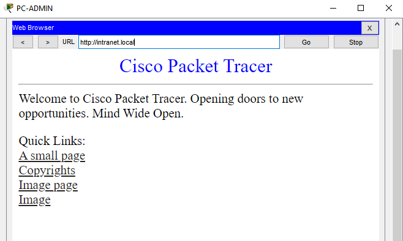
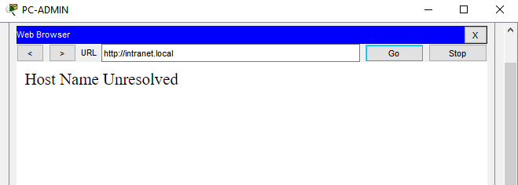
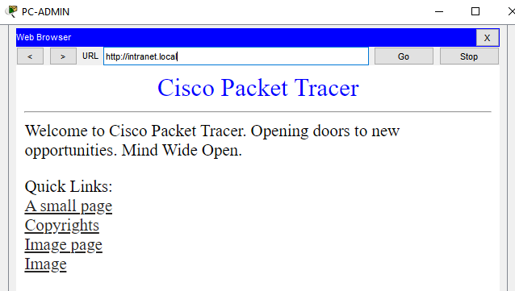

# Troubleshooting Case 1: VLAN 50 missing from the R1–SW1 trunk

Network: `v2-standout.pkt` (restored clean copy, saved as `v2-case1.pkt`). One change per fault. Session 6.

## Status

| Step | Status | Evidence |
| --- | --- | --- |
| Baseline (before fault) | Captured | Section 1 |
| Fault injected | Captured | Section 2 |
| Symptoms observed | Captured | Section 3 |
| Diagnosis | Captured | Section 4 |
| Fix and recovery | Captured | Section 5 |

## Summary

| Item | Record |
| --- | --- |
| **Symptom** | Hosts in other VLANs and the branch cannot reach the DNS and intranet servers (VLAN 50). Hostnames fail to resolve and `http://intranet.local` does not load. Internet access (`8.8.8.8`) still works. |
| **Scope** | Only VLAN 50 (`192.168.50.0/24`) and the services in it: DNS `192.168.50.10`, web `192.168.50.11`. VLANs 10, 20, 30, the branch LAN and the WAN path are unaffected. |
| **Layer** | Layer 2. The R1 route table and the `Gi0/0.50` subinterface look healthy, but VLAN 50 frames cannot cross the SW1–R1 trunk. |
| **Root cause** | VLAN 50 was removed from the allowed VLAN list on SW1 `Gi0/1` (the trunk to R1 `Gi0/0`). R1 `Gi0/0.50` is up/up but receives no VLAN 50 frames, so the frames R1 sends toward VLAN 50 are dropped at SW1 and nothing returns. |
| **Fix** | `switchport trunk allowed vlan add 50` on SW1 `Gi0/1`. |
| **Verification** | Server, DNS, web and branch tests pass again (Section 5). |

## 1. Baseline (before the fault)

From PC-ADMIN: `ping 192.168.50.10`, `nslookup intranet.local`, `ping 8.8.8.8`. Browse to `http://intranet.local`.

```
C:\>ping 192.168.50.10

Pinging 192.168.50.10 with 32 bytes of data:

Request timed out.
Reply from 192.168.50.10: bytes=32 time<1ms TTL=127
Reply from 192.168.50.10: bytes=32 time=1ms TTL=127
Reply from 192.168.50.10: bytes=32 time=1ms TTL=127

Ping statistics for 192.168.50.10:
    Packets: Sent = 4, Received = 3, Lost = 1 (25% loss),
Approximate round trip times in milli-seconds:
    Minimum = 0ms, Maximum = 1ms, Average = 0ms
```

```
C:\>nslookup intranet.local

Server: [192.168.50.10]
Address:  192.168.50.10

Non-authoritative answer:
Name:   intranet.local
Address:   192.168.50.11
```

```
C:\>ping 8.8.8.8

Pinging 8.8.8.8 with 32 bytes of data:

Request timed out.
Reply from 8.8.8.8: bytes=32 time<1ms TTL=254
Reply from 8.8.8.8: bytes=32 time=1ms TTL=254
Reply from 8.8.8.8: bytes=32 time=1ms TTL=254

Ping statistics for 8.8.8.8:
    Packets: Sent = 4, Received = 3, Lost = 1 (25% loss),
Approximate round trip times in milli-seconds:
    Minimum = 0ms, Maximum = 1ms, Average = 0ms
```

The first request of each baseline ping timed out while ARP resolved. This is normal and not a fault.



SW1: `show interfaces trunk`

```
SW1#show interfaces trunk 
Port        Mode         Encapsulation  Status        Native vlan
Fa0/23      on           802.1q         trunking      1
Fa0/24      on           802.1q         trunking      1
Gig0/1      on           802.1q         trunking      1

Port        Vlans allowed on trunk
Fa0/23      10,20,30,50
Fa0/24      10,20,30,50
Gig0/1      10,20,30,50

Port        Vlans allowed and active in management domain
Fa0/23      10,20,30,50
Fa0/24      10,20,30,50
Gig0/1      10,20,30,50

Port        Vlans in spanning tree forwarding state and not pruned
Fa0/23      10,20,30,50
Fa0/24      10,20,30,50
Gig0/1      10,20,30,50
```

Expected: `Gi0/1` allows VLANs 10, 20, 30, 50.

## 2. Fault injected

SW1:

```
SW1(config)#interface gigabitEthernet 0/1
SW1(config-if)#switchport trunk allowed vlan remove 50
```

```
SW1#show running-config | section interface GigabitEthernet0/1
interface GigabitEthernet0/1
 switchport trunk allowed vlan 10,20,30
 switchport mode trunk
```

## 3. Symptoms observed

| Test | Expected result | Observed |
| --- | --- | --- |
| PC-ADMIN `ping 192.168.50.10` | Fails (host unreachable or timeout) | FAIL |
| PC-ADMIN `nslookup intranet.local` | Times out | FAIL |
| PC-ADMIN `http://intranet.local` | Does not load | FAIL |
| PC-BRANCH `ping 192.168.50.11` | Fails | FAIL |
| DNS server `ping 192.168.50.1` | Fails | FAIL |
| DNS server `ping 192.168.50.11` (same VLAN, SW3 only) | Still succeeds | SUCCEED |
| PC-ADMIN `ping 8.8.8.8` | Still succeeds | SUCCEED |
| PC-ADMIN `ping` PC-BRANCH | Still succeeds | SUCCEED |

```
C:\>ping 192.168.50.10

Pinging 192.168.50.10 with 32 bytes of data:

Request timed out.
Request timed out.
Request timed out.
Request timed out.

Ping statistics for 192.168.50.10:
    Packets: Sent = 4, Received = 0, Lost = 4 (100% loss),
```



```
C:\>nslookup intranet.local

Server: [192.168.50.10]
Address:  192.168.50.10
DNS request timed out.
	timeout was 15000 milli seconds.
DNS request timed out.
	timeout was 15000 milli seconds.
DNS request timed out.
	timeout was 15000 milli seconds.
*** Request to 192.168.50.10 timed-out
```

DNS server:

```
C:\>ping 192.168.50.1

Pinging 192.168.50.1 with 32 bytes of data:

Request timed out.
Request timed out.
Request timed out.
Request timed out.

Ping statistics for 192.168.50.1:
    Packets: Sent = 4, Received = 0, Lost = 4 (100% loss),

C:\>ping 192.168.50.11

Pinging 192.168.50.11 with 32 bytes of data:

Reply from 192.168.50.11: bytes=32 time<1ms TTL=128
Reply from 192.168.50.11: bytes=32 time<1ms TTL=128
Reply from 192.168.50.11: bytes=32 time<1ms TTL=128
Reply from 192.168.50.11: bytes=32 time<1ms TTL=128

Ping statistics for 192.168.50.11:
    Packets: Sent = 4, Received = 4, Lost = 0 (0% loss),
Approximate round trip times in milli-seconds:
    Minimum = 0ms, Maximum = 0ms, Average = 0ms
```

```
C:\>ping 8.8.8.8

Pinging 8.8.8.8 with 32 bytes of data:

Reply from 8.8.8.8: bytes=32 time<1ms TTL=254
Reply from 8.8.8.8: bytes=32 time<1ms TTL=254
Reply from 8.8.8.8: bytes=32 time<1ms TTL=254
Reply from 8.8.8.8: bytes=32 time<1ms TTL=254

Ping statistics for 8.8.8.8:
    Packets: Sent = 4, Received = 4, Lost = 0 (0% loss),
Approximate round trip times in milli-seconds:
    Minimum = 0ms, Maximum = 0ms, Average = 0ms
```

PC-BRANCH:

```
C:\>ping 192.168.50.11

Pinging 192.168.50.11 with 32 bytes of data:

Request timed out.
Request timed out.
Request timed out.
Request timed out.

Ping statistics for 192.168.50.11:
    Packets: Sent = 4, Received = 0, Lost = 4 (100% loss),
```

PC-ADMIN to PC-BRANCH:

```
C:\>ping 192.168.40.51

Pinging 192.168.40.51 with 32 bytes of data:

Request timed out.
Reply from 192.168.40.51: bytes=32 time<1ms TTL=126
Reply from 192.168.40.51: bytes=32 time<1ms TTL=126
Reply from 192.168.40.51: bytes=32 time<1ms TTL=126

Ping statistics for 192.168.40.51:
    Packets: Sent = 4, Received = 3, Lost = 1 (25% loss),
Approximate round trip times in milli-seconds:
    Minimum = 0ms, Maximum = 0ms, Average = 0ms
```

## 4. Diagnosis

1. **Scope.** Only VLAN 50 and its services fail. Other VLANs, the branch and the WAN work, so the problem is specific to VLAN 50 and not a general routing or NAT fault.
2. **Routing check.** R1 still has the connected route and the subinterface is up/up, so this does not look like a routing fault.

```
R1#show ip interface brief 
Interface              IP-Address      OK? Method Status                Protocol 
GigabitEthernet0/0     unassigned      YES NVRAM  up                    up 
GigabitEthernet0/0.10  192.168.10.1    YES NVRAM  up                    up 
GigabitEthernet0/0.20  192.168.20.1    YES NVRAM  up                    up 
GigabitEthernet0/0.30  192.168.30.1    YES NVRAM  up                    up 
GigabitEthernet0/0.50  192.168.50.1    YES NVRAM  up                    up 
GigabitEthernet0/1     10.0.0.1        YES NVRAM  up                    up 
GigabitEthernet0/2     203.0.113.1     YES NVRAM  up                    up 
Vlan1                  unassigned      YES NVRAM  administratively down down
```

```
R1#show ip route | include 192.168.50
     192.168.50.0/24 is variably subnetted, 2 subnets, 2 masks
C       192.168.50.0/24 is directly connected, GigabitEthernet0/0.50
L       192.168.50.1/32 is directly connected, GigabitEthernet0/0.50
```

3. **ARP check.** R1's ARP table has no entry for `192.168.50.10` or `192.168.50.11`. R1 cannot learn the servers' MAC addresses, because its ARP requests go out tagged VLAN 50 and SW1 drops them at the trunk.

```
R1#show ip arp
Protocol  Address          Age (min)  Hardware Addr   Type   Interface
Internet  10.0.0.1                -   000C.CF11.E302  ARPA   GigabitEthernet0/1
Internet  10.0.0.2                0   000C.857E.1D01  ARPA   GigabitEthernet0/1
Internet  203.0.113.1             -   000C.CF11.E303  ARPA   GigabitEthernet0/2
Internet  203.0.113.2             0   0003.E412.A201  ARPA   GigabitEthernet0/2
```

4. **Trunk check.** SW1 `Gi0/1` no longer allows VLAN 50.

```
SW1#show interfaces trunk 
Port        Mode         Encapsulation  Status        Native vlan
Fa0/23      on           802.1q         trunking      1
Fa0/24      on           802.1q         trunking      1
Gig0/1      on           802.1q         trunking      1

Port        Vlans allowed on trunk
Fa0/23      10,20,30,50
Fa0/24      10,20,30,50
Gig0/1      10,20,30

Port        Vlans allowed and active in management domain
Fa0/23      10,20,30,50
Fa0/24      10,20,30,50
Gig0/1      10,20,30

Port        Vlans in spanning tree forwarding state and not pruned
Fa0/23      10,20,30,50
Fa0/24      10,20,30,50
Gig0/1      10,20,30
```

```
VLAN Name                             Status    Ports
---- -------------------------------- --------- -------------------------------
1    default                          active    Fa0/1, Fa0/2, Fa0/3, Fa0/4
                                                Fa0/5, Fa0/6, Fa0/7, Fa0/8
                                                Fa0/9, Fa0/10, Fa0/11, Fa0/12
                                                Fa0/13, Fa0/14, Fa0/15, Fa0/16
                                                Fa0/17, Fa0/18, Fa0/19, Fa0/20
                                                Fa0/21, Fa0/22, Gig0/2
10   ADMIN                            active    
20   USERS                            active    
30   IT                               active    
50   SERVERS                          active    
1002 fddi-default                     active    
1003 token-ring-default               active    
1004 fddinet-default                  active    
1005 trnet-default                    active 
```

VLAN 50 still exists on the switches and still crosses the inter-switch trunks `Fa0/23` and `Fa0/24`. Only the trunk toward R1 is missing it.

## 5. Fix and verification

SW1:

```
SW1(config)#interface gigabitEthernet 0/1
SW1(config-if)#switchport trunk allowed vlan add 50
```

```
SW1#show interfaces trunk 
Port        Mode         Encapsulation  Status        Native vlan
Fa0/23      on           802.1q         trunking      1
Fa0/24      on           802.1q         trunking      1
Gig0/1      on           802.1q         trunking      1

Port        Vlans allowed on trunk
Fa0/23      10,20,30,50
Fa0/24      10,20,30,50
Gig0/1      10,20,30,50

Port        Vlans allowed and active in management domain
Fa0/23      10,20,30,50
Fa0/24      10,20,30,50
Gig0/1      10,20,30,50

Port        Vlans in spanning tree forwarding state and not pruned
Fa0/23      10,20,30,50
Fa0/24      10,20,30,50
Gig0/1      10,20,30,50
```

The first ping may time out while ARP resolves.

PC-ADMIN:

```
C:\>ping 192.168.50.10

Pinging 192.168.50.10 with 32 bytes of data:

Reply from 192.168.50.10: bytes=32 time<1ms TTL=127
Reply from 192.168.50.10: bytes=32 time<1ms TTL=127
Reply from 192.168.50.10: bytes=32 time<1ms TTL=127
Reply from 192.168.50.10: bytes=32 time=1ms TTL=127

Ping statistics for 192.168.50.10:
    Packets: Sent = 4, Received = 4, Lost = 0 (0% loss),
Approximate round trip times in milli-seconds:
    Minimum = 0ms, Maximum = 1ms, Average = 0ms
```

```
C:\>nslookup intranet.local

Server: [192.168.50.10]
Address:  192.168.50.10

Non-authoritative answer:
Name:   intranet.local
Address:   192.168.50.11
```

PC-BRANCH:

```
C:\>ping 192.168.50.11

Pinging 192.168.50.11 with 32 bytes of data:

Request timed out.
Reply from 192.168.50.11: bytes=32 time<1ms TTL=126
Reply from 192.168.50.11: bytes=32 time=1ms TTL=126
Reply from 192.168.50.11: bytes=32 time<1ms TTL=126

Ping statistics for 192.168.50.11:
    Packets: Sent = 4, Received = 3, Lost = 1 (25% loss),
Approximate round trip times in milli-seconds:
    Minimum = 0ms, Maximum = 1ms, Average = 0ms
```

```
R1#show ip arp
Protocol  Address          Age (min)  Hardware Addr   Type   Interface
Internet  10.0.0.1                -   000C.CF11.E302  ARPA   GigabitEthernet0/1
Internet  10.0.0.2                2   000C.857E.1D01  ARPA   GigabitEthernet0/1
Internet  192.168.10.51           2   0001.42C4.85AA  ARPA   GigabitEthernet0/0.10
Internet  192.168.50.10           1   0060.47A7.E1CE  ARPA   GigabitEthernet0/0.50
Internet  192.168.50.11           0   0006.2AC4.021D  ARPA   GigabitEthernet0/0.50
Internet  203.0.113.1             -   000C.CF11.E303  ARPA   GigabitEthernet0/2
Internet  203.0.113.2             2   0003.E412.A201  ARPA   GigabitEthernet0/2
```



## Conclusion

- Configured: the fault (VLAN 50 removed from the SW1–R1 trunk) and the fix (VLAN 50 added back).
- Verified: the captures above. Before the fix, VLAN 50 services were unreachable from other VLANs and the branch. After the fix, the VLAN 50 tests pass again.
- Explained:
  - **Why the fault looked like a routing problem:** R1's `Gi0/0.50` stayed up/up and the connected route stayed in the table, because both depend on the physical port and not on the trunk's allowed list. Only the trunk output and R1's missing ARP entries for VLAN 50 reveal the break.
  - **Why the servers still talk to each other:** DNS and web are both on SW3 in VLAN 50. Their traffic stays at Layer 2 and never needs the SW1–R1 trunk.
  - **Why other VLANs and the WAN kept working:** VLANs 10, 20 and 30 are still in the allowed list, so their subinterfaces and the NAT path are untouched.
  - **Why hostnames failed:** the DNS server is in VLAN 50. When it was unreachable, name resolution failed even though the clients' DNS setting was still correct. This is a Layer 2 cause that shows up as a DNS symptom.
  - **Lesson:** a subinterface showing up/up does not prove its VLAN is carried on the trunk. Check `show interfaces trunk` and `show ip arp` when a gateway is "up" but its hosts are unreachable.