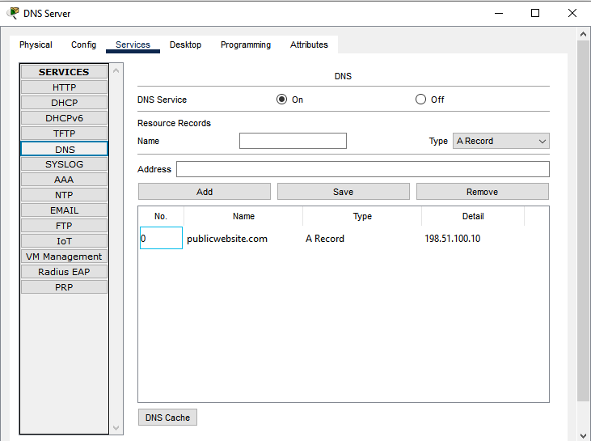

# Troubleshooting Case 6: DNS record for intranet.local missing

Network: `v2-standout.pkt` (restored clean copy). One change per fault. Session 7.

## Status

| Step | Status | Evidence |
| --- | --- | --- |
| Baseline (before fault) | Captured | Section 1 |
| Fault injected | Captured | Section 2 |
| Symptoms observed | Captured | Section 3 |
| Diagnosis | Captured | Section 4 |
| Fix and recovery | Captured | Section 5 |

## Summary

| Item | Record |
| --- | --- |
| **Symptom** | Clients cannot reach the intranet web server by name. `intranet.local` does not resolve ("Non-existent domain"), but the server answers when addressed by IP. |
| **Scope** | One hostname only. From HQ, `publicwebsite.com` still resolves and both the web server and the DNS server answer by IP. The branch gets the same failure for `intranet.local`, and its reply came from the DNS server, so the branch still reaches it. |
| **Layer** | Application layer (DNS name resolution). IP connectivity is fine. |
| **Root cause** | The `intranet.local` → `192.168.50.11` record was removed from the DNS server (`192.168.50.10`). The server is healthy but has no answer for that name. |
| **Fix** | Re-add the record `intranet.local` → `192.168.50.11` on the DNS server. |
| **Verification** | `nslookup` and `ping intranet.local` resolve to `192.168.50.11` again from PC-ADMIN, and `nslookup` works from PC-BRANCH (Section 5). |

## 1. Baseline (before the fault)

Expected: both names resolve through the DNS server `192.168.50.10`.

| Name | Expected address |
| --- | --- |
| `intranet.local` | `192.168.50.11` |
| `publicwebsite.com` | `198.51.100.10` |

PC-ADMIN: `nslookup intranet.local`, `nslookup publicwebsite.com`, `ping intranet.local`. Both names resolve as expected. The first ping request timed out while ARP resolved, which is normal.

```
C:\>nslookup intranet.local

Server: [192.168.50.10]
Address:  192.168.50.10

Non-authoritative answer:
Name:   intranet.local
Address:   192.168.50.11
           
C:\>nslookup publicwebsite.com

Server: [192.168.50.10]
Address:  192.168.50.10

Non-authoritative answer:
Name:   publicwebsite.com
Address:   198.51.100.10

C:\>ping intranet.local

Pinging 192.168.50.11 with 32 bytes of data:

Request timed out.
Reply from 192.168.50.11: bytes=32 time=10ms TTL=127
Reply from 192.168.50.11: bytes=32 time<1ms TTL=127
Reply from 192.168.50.11: bytes=32 time<1ms TTL=127

Ping statistics for 192.168.50.11:
    Packets: Sent = 4, Received = 3, Lost = 1 (25% loss),
Approximate round trip times in milli-seconds:
    Minimum = 0ms, Maximum = 10ms, Average = 3ms
```

## 2. Fault injected

DNS Server → Services → DNS: remove the `intranet.local` record. Leave `publicwebsite.com` and the DNS service itself unchanged.

## 3. Symptoms observed

| Test | Expected result | Observed |
| --- | --- | --- |
| PC-ADMIN `nslookup intranet.local` | Name not found | FAIL (Non-existent domain) |
| PC-ADMIN `ping intranet.local` | Cannot find host | FAIL (could not find host) |
| PC-ADMIN `ping 192.168.50.11` | Succeeds | SUCCEED |
| PC-ADMIN `nslookup publicwebsite.com` | Still resolves to `198.51.100.10` | SUCCEED |
| PC-BRANCH `nslookup intranet.local` | Name not found (same fault from the branch) | FAIL (Non-existent domain) |

PC-ADMIN:

```
C:\>nslookup intranet.local

Server: [192.168.50.10]
Address:  192.168.50.10
*** UnKnown can't find intranet.local: Non-existent domain.

C:\>ping intranet.local
Ping request could not find host intranet.local. Please check the name and try again.

C:\>ping 192.168.50.11

Pinging 192.168.50.11 with 32 bytes of data:

Reply from 192.168.50.11: bytes=32 time<1ms TTL=127
Reply from 192.168.50.11: bytes=32 time<1ms TTL=127
Reply from 192.168.50.11: bytes=32 time<1ms TTL=127
Reply from 192.168.50.11: bytes=32 time<1ms TTL=127

Ping statistics for 192.168.50.11:
    Packets: Sent = 4, Received = 4, Lost = 0 (0% loss),
Approximate round trip times in milli-seconds:
    Minimum = 0ms, Maximum = 0ms, Average = 0ms

C:\>nslookup publicwebsite.com

Server: [192.168.50.10]
Address:  192.168.50.10

Non-authoritative answer:
Name:   publicwebsite.com
Address:   198.51.100.10
```

PC-BRANCH:

```
C:\>nslookup intranet.local

Server: [192.168.50.10]
Address:  192.168.50.10
*** UnKnown can't find intranet.local: Non-existent domain.
```

## 4. Diagnosis

1. **Scope.** IP connectivity to the web server works, and the second name still resolves, so this is not a routing, trunk or DNS-service fault (pings in Section 3).
2. **Client DNS setting.** The client is configured correctly: its DNS server is `192.168.50.10`, learned by DHCP from R1.

```
C:\>ipconfig /all

FastEthernet0 Connection:(default port)

   Connection-specific DNS Suffix..: 
   Physical Address................: 0001.42C4.85AA
   Link-local IPv6 Address.........: FE80::201:42FF:FEC4:85AA
   IPv6 Address....................: ::
   IPv4 Address....................: 192.168.10.51
   Subnet Mask.....................: 255.255.255.0
   Default Gateway.................: ::
                                     192.168.10.1
   DHCP Servers....................: 192.168.10.1
   DHCPv6 IAID.....................: 
   DHCPv6 Client DUID..............: 00-01-00-01-64-E8-A0-B6-00-01-42-C4-85-AA
   DNS Servers.....................: ::
                                     192.168.50.10
```

3. **DNS server reachable.** `ping 192.168.50.10` succeeds, and `nslookup publicwebsite.com` is answered, so the server is up and responding.

```
C:\>ping 192.168.50.10

Pinging 192.168.50.10 with 32 bytes of data:

Reply from 192.168.50.10: bytes=32 time<1ms TTL=127
Reply from 192.168.50.10: bytes=32 time=10ms TTL=127
Reply from 192.168.50.10: bytes=32 time<1ms TTL=127
Reply from 192.168.50.10: bytes=32 time=1ms TTL=127

Ping statistics for 192.168.50.10:
    Packets: Sent = 4, Received = 4, Lost = 0 (0% loss),
Approximate round trip times in milli-seconds:
    Minimum = 0ms, Maximum = 10ms, Average = 2ms
```

4. **Record table.** DNS Server → Services → DNS shows no `intranet.local` entry, only `publicwebsite.com`. The DNS records are GUI-only, so this one screenshot is the direct evidence of the root cause.



## 5. Fix and verification

DNS Server → Services → DNS: add `intranet.local` with address `192.168.50.11` (A record). Keep the DNS service On.

PC-ADMIN:

```
C:\>nslookup intranet.local

Server: [192.168.50.10]
Address:  192.168.50.10

Non-authoritative answer:
Name:   intranet.local
Address:   192.168.50.11
           
C:\>ping intranet.local

Pinging 192.168.50.11 with 32 bytes of data:

Reply from 192.168.50.11: bytes=32 time<1ms TTL=127
Reply from 192.168.50.11: bytes=32 time=1ms TTL=127
Reply from 192.168.50.11: bytes=32 time<1ms TTL=127
Reply from 192.168.50.11: bytes=32 time<1ms TTL=127

Ping statistics for 192.168.50.11:
    Packets: Sent = 4, Received = 4, Lost = 0 (0% loss),
Approximate round trip times in milli-seconds:
    Minimum = 0ms, Maximum = 1ms, Average = 0ms
```

PC-BRANCH:

```
C:\>nslookup intranet.local

Server: [192.168.50.10]
Address:  192.168.50.10

Non-authoritative answer:
Name:   intranet.local
Address:   192.168.50.11
```

## Conclusion

- Configured: the fault (`intranet.local` record removed) and the fix (record re-added).
- Verified: the captures above. Before the fault, both names resolved. With the fault, `intranet.local` returned "Non-existent domain" from PC-ADMIN and PC-BRANCH, while `ping 192.168.50.11`, `ping 192.168.50.10` and `nslookup publicwebsite.com` still worked. After the fix, `intranet.local` resolves to `192.168.50.11` again from PC-ADMIN (nslookup and ping) and from PC-BRANCH (nslookup).
- Explained:
  - **Why the web server still answered by IP:** DNS only translates names to addresses. Removing a record does not touch routing or switching, so `192.168.50.11` stayed reachable.
  - **Why `publicwebsite.com` kept working:** each name is its own record, and the DNS service was still running.
  - **Why this differs from Case 1:** in Case 1, the DNS server was unreachable (a Layer 2 cause) and every name failed. Here the server is reachable and answers other names, and only one name is missing.
  - **Lesson:** test the IP first, then the name, then compare with a second name. That separates a connectivity fault from a missing record before you open the DNS server.