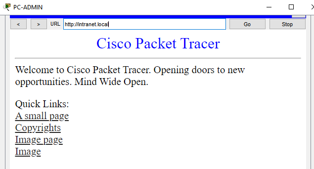
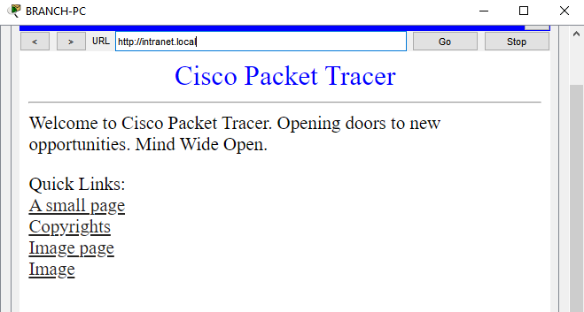
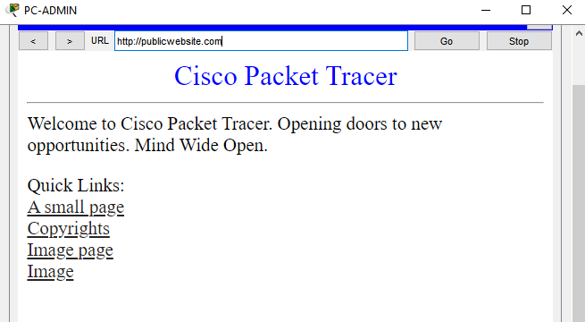

# DNS and Web Verification: v2-standout

Network: `v2-standout.pkt`. DNS server: 192.168.50.10 (VLAN 50). Intranet web server: 192.168.50.11. Simulated public web server: 198.51.100.10 (behind R3).

| Hostname | Address |
| --- | --- |
| intranet.local | 192.168.50.11 |
| publicwebsite.com | 198.51.100.10 |

## Evidence

1. **Name resolution.** From PC-ADMIN, run `nslookup intranet.local` and `nslookup publicwebsite.com`.
   Expected: 192.168.50.11 and 198.51.100.10.

```
C:\>nslookup intranet.local

Server: [192.168.50.10]
Address:  192.168.50.10

Non-authoritative answer:
Name:   intranet.local
Address:   192.168.50.11
           
C:\>nslookup publicwebsite.com

Server: [192.168.50.10]
Address:  192.168.50.10

Non-authoritative answer:
Name:   publicwebsite.com
Address:   198.51.100.10
```

2. **Internal web page by hostname.** Screenshot `http://intranet.local` from PC-ADMIN and from PC-BRANCH.
   Expected: the page loads from both. The branch result also confirms the R2 route to VLAN 50.





3. **Public web page by hostname.** Screenshot `http://publicwebsite.com` from PC-ADMIN.
   Expected: the page loads.



## Result

Both hostnames resolve. The intranet page loads from an HQ client and from the branch, and the public page loads from an HQ client.

## Conclusion

- Configured: DNS service with two records, HTTP on both web servers, and the DNS option in DHCP.
- Verified: the three captures above.
- Explained:
  - Routing gets packets to a server's IP address; DNS turns a name into that address. They fail independently.
  - If the IP address works but the hostname fails, check the DNS record or the client's DNS setting.
  - If neither works, fix routing, gateway or NAT first.